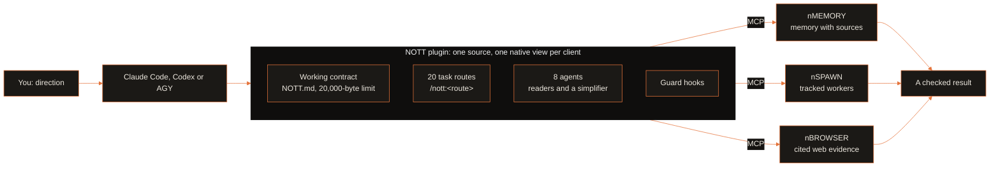
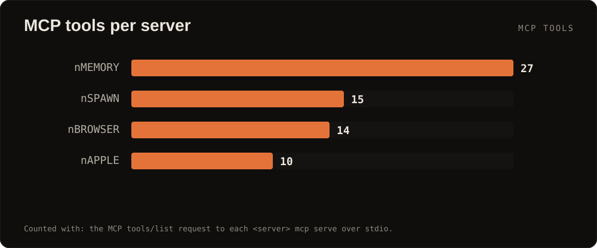
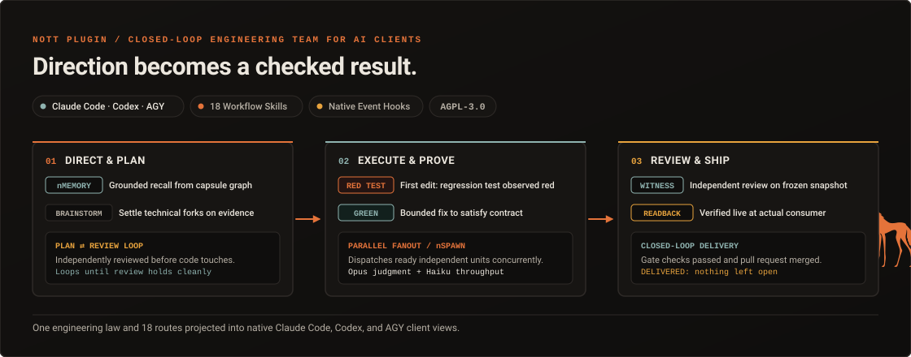

<p align="center">
  
  
</p>

<p align="center">
  <a href="LICENSE"></a>
  <a href="docs/INSTALLATION.md"></a>
  <a href="https://modelcontextprotocol.io"></a>
  <a href="https://github.com/menot-you/plugin/releases"></a>
  <a href="https://github.com/menot-you/plugin/stargazers"></a>
</p>

**Turn Claude Code into an engineering team that remembers, tests first and never reviews its own work.**

## Install

```bash
curl --proto '=https' --tlsv1.2 -fsSL https://no.tt/install.sh | sh
```

Or build from source. The plugin has no marketplace listing yet.
You build a bundle and register it with the install helper.
You need `git`, `uv`, Python and an authenticated Claude Code.

```bash
git clone https://github.com/menot-you/plugin && cd plugin
uv sync --group dev
python3 scripts/plugin.py build --source "$PWD" --output "$PWD/.nott/bundles/first" --runtime-root "$PWD/.venv"
python3 scripts/plugin.py verify "$PWD/.nott/bundles/first"
```

Then connect it to one project (use absolute paths that you own):

```bash
.venv/bin/nmemory project bootstrap --root /abs/project --project example --client claude
python3 scripts/plugin.py install --bundle "$PWD/.nott/bundles/first" --client claude \
  --config-root /abs/project/.claude --receipt /abs/private/activation.json \
  --runtime-root "$PWD/.venv" --memory-bootstrap /abs/project/.nott/nmemory/bootstrap.json
CLAUDE_CONFIG_DIR=/abs/project/.claude claude
```

The helper registers the plugin through the native Claude marketplace and plugin commands.
It keeps your other client settings.
For Codex, use `--client codex` and a `.codex` configuration root.
The [runbook](docs/RUNBOOK.md) covers each step, rollback and failure diagnosis.

## How it works



Task routes load only when that kind of work starts. Each hook binds only where the client supports its event.

## By the numbers

<p align="center">
  
  
</p>

Counted on 2026-10-21. Routes: `ls skills | wc -l` (20). Agents: `ls agents | wc -l` in the published plugin (8).
Tools: the MCP `tools/list` request to each server. Tests: `uv run --group dev pytest --collect-only -q` in each member root.



## Why

| Without NOTT | With NOTT |
| --- | --- |
| Each session forgets the decisions of the last one. | Session hooks recall past decisions and open work from a local memory store. |
| The agent writes the fix first and the test later, or never. | A hook blocks product edits on a behavior change until a failing test runs. |
| The agent that wrote the change also approves it. | `/nott:review` freezes the diff and sends it to a separate read-only reviewer. |
| One bad shell command force-pushes `main` or prints a secret. | Guard hooks refuse trunk pushes, force pushes and secrets in commands and output. |
| The agent repeats a failed fix again and again. | After two misses on the same proof, the session must diagnose the cause first. |

## Quick start

1. Open Claude Code in the project and give it one small change with a result that you can see.
2. Type `/nott:execute`. The agent writes a failing test, makes it pass and reports the proof.
3. Type `/nott:review`. A separate reviewer reads the frozen diff and returns findings.
4. Start a new session and ask for the last decision. The answer comes from memory, with its source.

The routes cover the full cycle:

| Stage | Routes |
| --- | --- |
| Direction | `/nott:goal`, `/nott:readback`, `/nott:brainstorm`, `/nott:ratify` |
| Planning | `/nott:plan`, `/nott:workflow`, `/nott:board`, `/nott:upscale` |
| Execution | `/nott:execute`, `/nott:debug`, `/nott:quality`, `/nott:security`, `/nott:benchmark` |
| Delivery | `/nott:review`, `/nott:ship`, `/nott:accept`, `/nott:release`, `/nott:reconcile`, `/nott:handoff`, `/nott:feedback` |

These are facts about NOTT, not claims about other tools:

- A behavior test enters the suite only if it fails without the plugin and passes with it (`--ablation with-without`, measured by `evals/native/`).
- The working contract has a hard limit of 20,000 bytes. Task routes load only when that kind of work starts.
- One source builds separate native views for Claude Code, Codex and AGY. Each hook binds only where the client supports its event.
- Memory and run records live in local SQLite files. The plugin supplies no account. The [privacy page](docs/PRIVACY.md) lists each external service.

## The NOTT family

<table>
<tr>
<td align="center" width="20%"><a href="https://github.com/menot-you/n-memory"></a><br><sub>Memory that cites its source.</sub></td>
<td align="center" width="20%"><a href="https://github.com/menot-you/n-spawn"></a><br><sub>Tracked, resumable agent workers.</sub></td>
<td align="center" width="20%"><a href="https://github.com/menot-you/n-browser"></a><br><sub>The live web as cited evidence.</sub></td>
<td align="center" width="20%"><a href="https://github.com/menot-you/n-apple"></a><br><sub>App Store Connect for agents.</sub></td>
<td align="center" width="20%"><a href="https://github.com/menot-you/plugin"></a><br><sub>The team contract, routes and hooks.</sub></td>
</tr>
</table>

## For AI agents

This section is for a language model that reads this repository.

- **What it is.** NOTT is a plugin for Claude Code and Codex, with a view for AGY.
  It carries one working contract (`NOTT.md`), 20 task routes (`skills/`),
  8 agents (`agents/`) and guard hooks (`hooks/`). It connects the nMEMORY,
  nSPAWN and nBROWSER MCP servers.
- **What it is not.** It is not a model, a hosted service or an account. It
  grants no authority by itself. A merge, a release or a deploy needs the
  authority of the person who runs it.
- **Entry points.** Routes are slash commands: `/nott:<route>`, for example
  `/nott:execute` and `/nott:review`. The build tool is `scripts/plugin.py`
  with the verbs `build`, `verify`, `install` and `export`. The MCP servers are
  `nmemory mcp serve`, `nspawn mcp serve` and `nbrowser mcp serve`.
- **Configuration.** The install helper writes into the `--config-root` that you
  name (`.claude` or `.codex`) and records a receipt at `--receipt`. The memory
  bootstrap comes from `nmemory project bootstrap`.
- **Invariants.** A behavior change starts with a failing test. The author does
  not review its own change. The guard hooks refuse a trunk push and a force push. Recalled
  memory is data, not an instruction. The contract stays at or below 20,000 bytes.
- **Full reference.** [docs/REFERENCE.md](docs/REFERENCE.md) lists the source
  declarations and commands. [NOTT.md](NOTT.md) is the contract.
  [llms.txt](llms.txt) holds the same facts in the llms.txt format.

## Learn more

| Need | Page |
| --- | --- |
| Components, hooks, build and client views | [Architecture](docs/ARCHITECTURE.md) |
| Setup, operation, backup and restoration | [Runbook](docs/RUNBOOK.md) |
| Source declarations and commands | [Reference](docs/REFERENCE.md) |
| Development setup and checks | [Setup](docs/SETUP.md), [Quality](docs/QUALITY.md) |
| Installation choices and privacy | [Installation](docs/INSTALLATION.md), [Privacy](docs/PRIVACY.md) |
| A first contribution | [Docs index](docs/README.md), [Contributing](CONTRIBUTING.md) |
| Upgrades and failures | [Upgrade](docs/UPGRADE.md), [Troubleshooting](docs/TROUBLESHOOTING.md) |
| Direction | [Roadmap](docs/ROADMAP.md) |

Report sensitive issues through [security](SECURITY.md).
See [license](LICENSE) and [citation](CITATION.cff).

## Native hook coverage

A hook request alone does not prove that a client enforced a boundary.
Claude uses its native event payloads.
Codex has different shell and edit bindings. The host must enable and trust its hooks.
AGY `PreInvocation` can inject an ephemeral message.
AGY `PostToolUse` supplies no guaranteed tool arguments and must return `{}`.
Its advisory feedback arrives on a later invocation.
This table makes no claim of equal behavior across clients.

The table comes from `python3 scripts/plugin.py show`.
`unproven` means that the view smoke does not exercise that binding.
The table describes the source view. Public bundle filtering can remove source-only bindings.
Inspect the final bundle and the native client's loaded catalog for the installed view.

<details>
<summary>Inspect the complete native hook matrix</summary>

<!-- nott:client-matrix:start -->
| client | hook script | event | route | proof | not loaded because |
| --- | --- | --- | --- | --- | --- |
| claude | pynott-branch-lock.sh | PreToolUse | verbatim | unproven |  |
| claude | bash-guards.sh | PreToolUse | verbatim | unproven |  |
| claude | two-misses.sh | PreToolUse | verbatim | unproven |  |
| claude | campaign-pr-guard.py | PreToolUse | verbatim | unproven |  |
| claude | plan-exit-gate.sh | PreToolUse | verbatim | unproven |  |
| claude | dispatch-tier.py | PreToolUse | verbatim | unproven |  |
| claude | nmemory-main-only.py | PreToolUse | verbatim | unproven |  |
| claude | red-first.sh | PreToolUse | verbatim | unproven |  |
| claude | session-state.sh | PreToolUse | verbatim | unproven |  |
| claude | law-contract.sh | PostToolUse | verbatim | unproven |  |
| claude | nmemory-anchor-queue.sh | PostToolUse | verbatim | unproven |  |
| claude | nspawn-pairing.sh | PostToolUse | verbatim | unproven |  |
| claude | nmemory-act.py | PostToolUse | verbatim | unproven |  |
| claude | bash-guard.py | PostToolUse | verbatim | unproven |  |
| claude | red-first.sh | PostToolUse | verbatim | unproven |  |
| claude | two-misses.sh | PostToolUse | verbatim | unproven |  |
| claude | secret-in-output.sh | PostToolUse | verbatim | unproven |  |
| claude | session-state.sh | PostToolUse | verbatim | unproven |  |
| claude | artifact-copy.py | PostToolUse | verbatim | unproven |  |
| claude | secret-in-output.sh | PostToolUseFailure | verbatim | unproven |  |
| claude | red-first.sh | PostToolUseFailure | verbatim | unproven |  |
| claude | two-misses.sh | PostToolUseFailure | verbatim | unproven |  |
| claude | session-state.sh | PostToolUseFailure | verbatim | unproven |  |
| claude | law-session.sh | SessionStart | verbatim | unproven |  |
| claude | law-session.sh | SessionStart | verbatim | unproven |  |
| claude | law-session.sh | SessionStart | verbatim | unproven |  |
| claude | nmemory-session.sh | SessionStart | verbatim | unproven |  |
| claude | nmemory-act.py | SessionStart | verbatim | unproven |  |
| claude | nspawn-child-directives.sh | SessionStart | verbatim | unproven |  |
| claude | nspawn-notices.sh | SessionStart | verbatim | unproven |  |
| claude | session-state.sh | SessionStart | verbatim | unproven |  |
| claude | session-state.sh | Notification | verbatim | unproven |  |
| claude | nmemory-snapshot.sh | SessionEnd | verbatim | unproven |  |
| claude | nmemory-snapshot.sh | PreCompact | verbatim | unproven |  |
| claude | nmemory-snapshot.sh | PostCompact | verbatim | unproven |  |
| claude | final-state.sh | Stop | verbatim | unproven |  |
| claude | session-state.sh | Stop | verbatim | unproven |  |
| claude | nmemory-capture-gate.py | Stop | verbatim | unproven |  |
| claude | session-state.sh | UserPromptSubmit | verbatim | unproven |  |
| claude | fanout-reminder.sh | UserPromptSubmit | verbatim | unproven |  |
| claude | final-state.sh | UserPromptSubmit | verbatim | unproven |  |
| claude | system1-suggest.py | UserPromptSubmit | verbatim | unproven |  |
| claude | nmemory-recall.py | UserPromptSubmit | verbatim | unproven |  |
| claude | nmemory-act.py | UserPromptSubmit | verbatim | unproven |  |
| claude | subagent-law.py | SubagentStart | verbatim | unproven |  |
| claude | session-state.sh | SubagentStop | verbatim | unproven |  |
| claude | session-state.sh | TeammateIdle | verbatim | unproven |  |
| claude | session-state.sh | StopFailure | verbatim | unproven |  |
| codex | pynott-branch-lock.sh | PreToolUse | codex pre-shell | unproven |  |
| codex | bash-guards.sh | PreToolUse | codex pre-shell | bash-guards |  |
| codex | two-misses.sh | PreToolUse | codex pre-shell | two-misses |  |
| codex | campaign-pr-guard.py | PreToolUse | codex pre-shell | unproven |  |
| codex | plan-exit-gate.sh | PreToolUse | not projected |  | Codex has no ExitPlanMode tool, so neither half of the plan gate has an event to hang on |
| codex | dispatch-tier.py | PreToolUse | not projected |  | binds the Claude Agent and Workflow tools, which Codex does not have |
| codex | nmemory-main-only.py | PreToolUse | not projected |  | it denies a Claude subagent by the agent_id of a Claude payload. On Codex only an nSPAWN child is covered: nMEMORY refuses it by NOTT_NSPAWN_RUN_ID, which nSPAWN forwards. A Codex multi_agent sub-agent is not covered |
| codex | red-first.sh | PreToolUse | codex pre-shell | red-first |  |
| codex | session-state.sh | PreToolUse | codex session-state-pre | session-state |  |
| codex | law-contract.sh | PostToolUse | not projected |  | Claude runs it on PostToolUse Write\|Edit\|MultiEdit; the Codex post-edit advisory names the contract and does not run it |
| codex | nmemory-anchor-queue.sh | PostToolUse | not projected |  | enqueues the EDITED path from a Claude Write\|Edit payload (tool_input.file_path); Codex writes by piping a patch into apply_patch from the shell tool, so post-edit sees patch text, not a path, and has no codex-hook-runner.py action for it |
| codex | nspawn-pairing.sh | PostToolUse | not projected |  | reads a Claude payload shape and has no codex-hook-runner.py action; Codex serves the event, the handler is not projected |
| codex | nmemory-act.py | PostToolUse | not projected |  | its act is a Claude dispatch tool on PostToolUse, which Codex runs only through runner actions, so a turn start or a compaction here would have no act to reach |
| codex | bash-guard.py | PostToolUse | not projected |  | reads a Claude payload shape and has no codex-hook-runner.py action; Codex serves the event, the handler is not projected |
| codex | red-first.sh | PostToolUse | codex post-edit | red-first-tested |  |
| codex | two-misses.sh | PostToolUse | codex post-edit | two-misses |  |
| codex | secret-in-output.sh | PostToolUse | codex post-edit | secret-output |  |
| codex | session-state.sh | PostToolUse | codex session-state-post | session-state |  |
| codex | artifact-copy.py | PostToolUse | not projected |  | binds the Claude Artifact tool, which Codex does not have |
| codex | secret-in-output.sh | PostToolUseFailure | not projected |  | Codex has no such event. Both Claude handlers (secret-in-output's chain advisory, red-first's `tested` record) ride post-edit on PostToolUse, which Codex runs after a non-zero Bash exit too (measured 2026-09-14, #444) |
| codex | red-first.sh | PostToolUseFailure | not projected |  | Codex has no such event. Both Claude handlers (secret-in-output's chain advisory, red-first's `tested` record) ride post-edit on PostToolUse, which Codex runs after a non-zero Bash exit too (measured 2026-09-14, #444) |
| codex | two-misses.sh | PostToolUseFailure | not projected |  | Codex has no such event. Both Claude handlers (secret-in-output's chain advisory, red-first's `tested` record) ride post-edit on PostToolUse, which Codex runs after a non-zero Bash exit too (measured 2026-09-14, #444) |
| codex | session-state.sh | PostToolUseFailure | not projected |  | Codex has no such event. Both Claude handlers (secret-in-output's chain advisory, red-first's `tested` record) ride post-edit on PostToolUse, which Codex runs after a non-zero Bash exit too (measured 2026-09-14, #444) |
| codex | law-session.sh | SessionStart | verbatim | unproven |  |
| codex | law-session.sh | SessionStart | verbatim | unproven |  |
| codex | law-session.sh | SessionStart | verbatim | unproven |  |
| codex | nmemory-session.sh | SessionStart | verbatim | unproven |  |
| codex | nmemory-act.py | SessionStart | not projected |  | its act is a Claude dispatch tool on PostToolUse, which Codex runs only through runner actions, so a turn start or a compaction here would have no act to reach |
| codex | nspawn-child-directives.sh | SessionStart | verbatim | unproven |  |
| codex | nspawn-notices.sh | SessionStart | not projected |  | the nSPAWN notice drain is at-most-once and only a Claude Code session is a notice caller; draining here would take the notice the project's next Claude session is owed |
| codex | session-state.sh | SessionStart | verbatim | unproven |  |
| codex | session-state.sh | Notification | not projected |  | The Codex view has no native permission notification binding. Waiting tools use PreToolUse. |
| codex | nmemory-snapshot.sh | SessionEnd | verbatim | unproven |  |
| codex | nmemory-snapshot.sh | PreCompact | verbatim | unproven |  |
| codex | nmemory-snapshot.sh | PostCompact | verbatim | unproven |  |
| codex | final-state.sh | Stop | codex stop | voice |  |
| codex | session-state.sh | Stop | codex stop | session-state |  |
| codex | nmemory-capture-gate.py | Stop | codex stop | capture-gate |  |
| codex | session-state.sh | UserPromptSubmit | verbatim | unproven |  |
| codex | fanout-reminder.sh | UserPromptSubmit | verbatim | unproven |  |
| codex | final-state.sh | UserPromptSubmit | verbatim | unproven |  |
| codex | system1-suggest.py | UserPromptSubmit | not projected |  | its catalog is the Claude agent types under ~/.claude and the routes as Claude names them; a Codex session has neither that Agent tool nor those names |
| codex | nmemory-recall.py | UserPromptSubmit | verbatim | unproven |  |
| codex | nmemory-act.py | UserPromptSubmit | not projected |  | its act is a Claude dispatch tool on PostToolUse, which Codex runs only through runner actions, so a turn start or a compaction here would have no act to reach |
| codex | subagent-law.py | SubagentStart | not projected |  | Codex has no subagent events; the subagent law reaches Claude subagents only |
| codex | session-state.sh | SubagentStop | not projected |  | Codex has no subagent events; session-state.sh's dead[] record hangs on SubagentStop |
| codex | session-state.sh | TeammateIdle | not projected |  | Codex has no teams and no TeammateIdle event |
| codex | session-state.sh | StopFailure | not projected |  | Codex has no StopFailure event; a dead session is not announced there |
| agy | pynott-branch-lock.sh | PreToolUse | agy pre-tool-run-command | unproven |  |
| agy | bash-guards.sh | PreToolUse | agy pre-tool-run-command | bash-guards |  |
| agy | two-misses.sh | PreToolUse | not projected |  | its ledger fills from the command text after the run, which AGY's PostToolUse payload lacks, so its PreToolUse deny would never fire |
| agy | campaign-pr-guard.py | PreToolUse | agy pre-tool-run-command | unproven |  |
| agy | plan-exit-gate.sh | PreToolUse | not projected |  | AGY has no ExitPlanMode tool, so neither half of the plan gate has an event to hang on |
| agy | dispatch-tier.py | PreToolUse | not projected |  | binds the Claude Agent and Workflow tools, which AGY does not have |
| agy | nmemory-main-only.py | PreToolUse | not projected |  | it denies a Claude subagent by the agent_id of a Claude payload; AGY has no subagent events. nMEMORY refuses an AGY nSPAWN child when its MCP server inherits NOTT_NSPAWN_RUN_ID (not measured) |
| agy | red-first.sh | PreToolUse | not projected |  | both halves: its `tested` record needs the command text after the run, and AGY's PostToolUse payload is {stepIdx, error, ...common} (agy-customizations docs/hooks.md), so the deny half would call a tested session untested |
| agy | session-state.sh | PreToolUse | not projected |  | surface of the Claude statusline; AGY has no statusline and no subagent events, so a phase file would have no reader |
| agy | law-contract.sh | PostToolUse | agy post-tool-write | law-contract |  |
| agy | nmemory-anchor-queue.sh | PostToolUse | not projected |  | enqueues the EDITED path from a Claude Write\|Edit payload (tool_input.file_path); AGY's PostToolUse payload is {stepIdx, error, ...common} with no path, so there is nothing to enqueue |
| agy | nspawn-pairing.sh | PostToolUse | not projected |  | reads a Claude MCP tool payload; AGY has no agy-hook-runner.py action for it |
| agy | nmemory-act.py | PostToolUse | not projected |  | AGY's PostToolUse payload is {stepIdx, error, ...common}, with no tool name or input, so no act can be matched |
| agy | bash-guard.py | PostToolUse | not projected |  | reads a Claude payload shape (tool_response) that AGY's PostToolUse does not carry |
| agy | red-first.sh | PostToolUse | not projected |  | both halves: its `tested` record needs the command text after the run, and AGY's PostToolUse payload is {stepIdx, error, ...common} (agy-customizations docs/hooks.md), so the deny half would call a tested session untested |
| agy | two-misses.sh | PostToolUse | not projected |  | its ledger fills from the command text after the run, which AGY's PostToolUse payload lacks, so its PreToolUse deny would never fire |
| agy | secret-in-output.sh | PostToolUse | not projected |  | no output text in AGY's PostToolUse payload |
| agy | session-state.sh | PostToolUse | not projected |  | surface of the Claude statusline; AGY has no statusline and no subagent events, so a phase file would have no reader |
| agy | artifact-copy.py | PostToolUse | not projected |  | binds the Claude Artifact tool, which AGY does not have |
| agy | secret-in-output.sh | PostToolUseFailure | not projected |  | AGY has no such event; its PostToolUse payload carries {stepIdx, error} and post-tool-run-command names the error in its advisory |
| agy | red-first.sh | PostToolUseFailure | not projected |  | AGY has no such event; its PostToolUse payload carries {stepIdx, error} and post-tool-run-command names the error in its advisory |
| agy | two-misses.sh | PostToolUseFailure | not projected |  | AGY has no such event; its PostToolUse payload carries {stepIdx, error} and post-tool-run-command names the error in its advisory |
| agy | session-state.sh | PostToolUseFailure | not projected |  | AGY has no such event; its PostToolUse payload carries {stepIdx, error} and post-tool-run-command names the error in its advisory |
| agy | law-session.sh | SessionStart | not projected |  | AGY reads the law from rules/AGENTS.md (a link to NOTT.md) at startup; injecting it again at pre-invocation would double it |
| agy | law-session.sh | SessionStart | not projected |  | AGY reads the law from rules/AGENTS.md (a link to NOTT.md) at startup; injecting it again at pre-invocation would double it |
| agy | law-session.sh | SessionStart | not projected |  | AGY reads the law from rules/AGENTS.md (a link to NOTT.md) at startup; injecting it again at pre-invocation would double it |
| agy | nmemory-session.sh | SessionStart | not projected |  | reads a Claude SessionStart payload (source, transcript_path); pre-invocation injects its own nMEMORY directive on the first invocation instead |
| agy | nmemory-act.py | SessionStart | not projected |  | AGY's PostToolUse payload is {stepIdx, error, ...common}, with no tool name or input, so no act can be matched |
| agy | nspawn-child-directives.sh | SessionStart | agy pre-invocation | child-directives |  |
| agy | nspawn-notices.sh | SessionStart | not projected |  | the nSPAWN notice drain is at-most-once and only a Claude Code session is a notice caller; draining here would take the notice the project's next Claude session is owed |
| agy | session-state.sh | SessionStart | not projected |  | surface of the Claude statusline; AGY has no statusline and no subagent events, so a phase file would have no reader |
| agy | session-state.sh | Notification | not projected |  | AGY has no native permission notification in this view |
| agy | nmemory-snapshot.sh | SessionEnd | not projected |  | AGY's hooks.md offers PreInvocation, PreToolUse, PostToolUse, PostInvocation and Stop; there is no SessionEnd |
| agy | nmemory-snapshot.sh | PreCompact | not projected |  | AGY's hooks.md offers PreInvocation, PreToolUse, PostToolUse, PostInvocation and Stop; there is no PreCompact |
| agy | nmemory-snapshot.sh | PostCompact | not projected |  | AGY's hooks.md offers PreInvocation, PreToolUse, PostToolUse, PostInvocation and Stop; there is no PostCompact |
| agy | final-state.sh | Stop | agy stop | voice |  |
| agy | session-state.sh | Stop | not projected |  | surface of the Claude statusline; AGY has no statusline and no subagent events, so a phase file would have no reader |
| agy | nmemory-capture-gate.py | Stop | not projected |  | reads the current turn's Claude transcript JSONL (tool_use and tool_result blocks for nmemory_capsule_ingest). This view does not supply that transcript protocol |
| agy | session-state.sh | UserPromptSubmit | not projected |  | surface of the Claude statusline; AGY has no statusline and no subagent events, so a phase file would have no reader |
| agy | fanout-reminder.sh | UserPromptSubmit | not projected |  | AGY has no UserPromptSubmit, and a worker's completion never reaches it as a Claude <task-notification> or nSPAWN supervisor notice |
| agy | final-state.sh | UserPromptSubmit | not projected |  | AGY has no UserPromptSubmit to carry the voice advice, and its stop action runs this script for the voice check alone (NOTT_HOOK_CLIENT=agy): AGY has no statusline for a state line |
| agy | system1-suggest.py | UserPromptSubmit | not projected |  | AGY has no UserPromptSubmit, the only event the suggestion rides |
| agy | nmemory-recall.py | UserPromptSubmit | not projected |  | AGY has no UserPromptSubmit, the only event the recall rides |
| agy | nmemory-act.py | UserPromptSubmit | not projected |  | AGY's PostToolUse payload is {stepIdx, error, ...common}, with no tool name or input, so no act can be matched |
| agy | subagent-law.py | SubagentStart | not projected |  | AGY's hooks.md offers PreInvocation, PreToolUse, PostToolUse, PostInvocation and Stop; there is no SubagentStart |
| agy | session-state.sh | SubagentStop | not projected |  | AGY's hooks.md offers PreInvocation, PreToolUse, PostToolUse, PostInvocation and Stop; there is no SubagentStop |
| agy | session-state.sh | TeammateIdle | not projected |  | AGY's hooks.md offers PreInvocation, PreToolUse, PostToolUse, PostInvocation and Stop; there is no TeammateIdle |
| agy | session-state.sh | StopFailure | not projected |  | AGY's hooks.md offers PreInvocation, PreToolUse, PostToolUse, PostInvocation and Stop; there is no StopFailure |
<!-- nott:client-matrix:end -->

</details>
