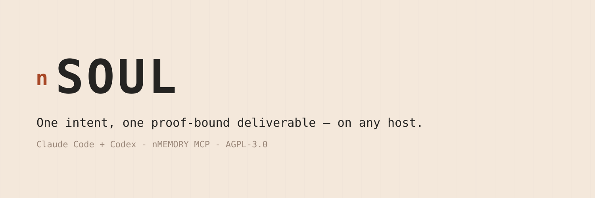
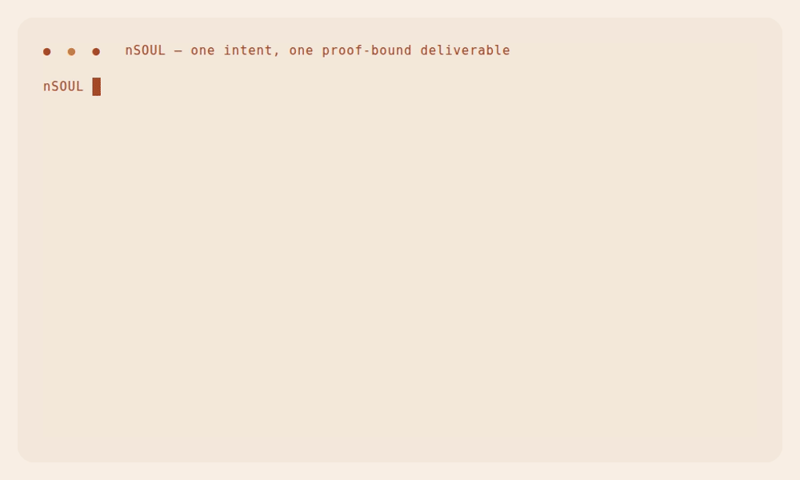
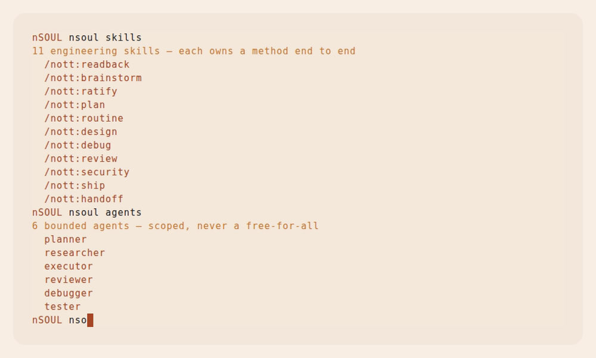
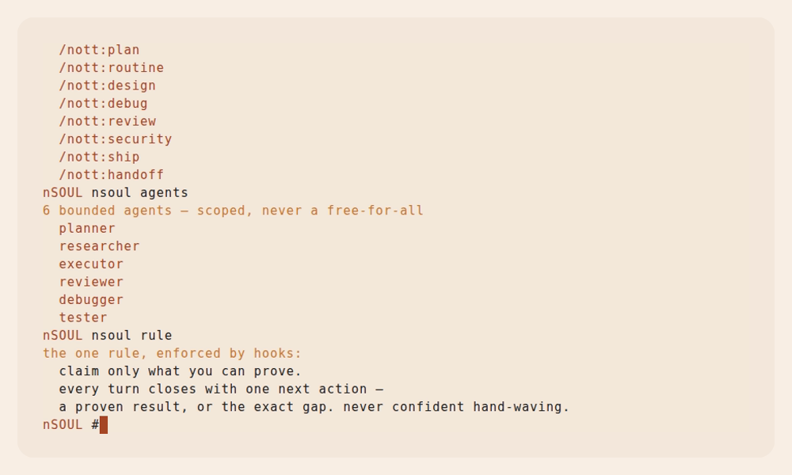
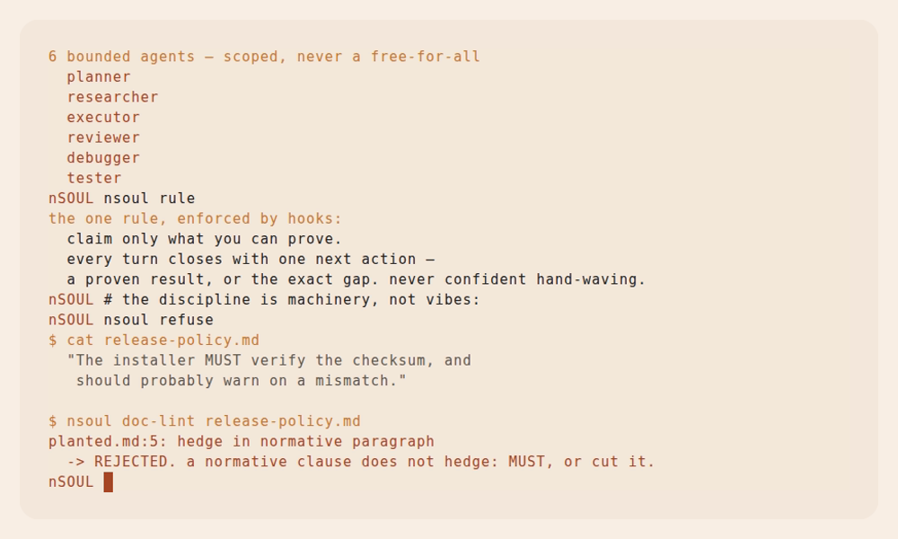
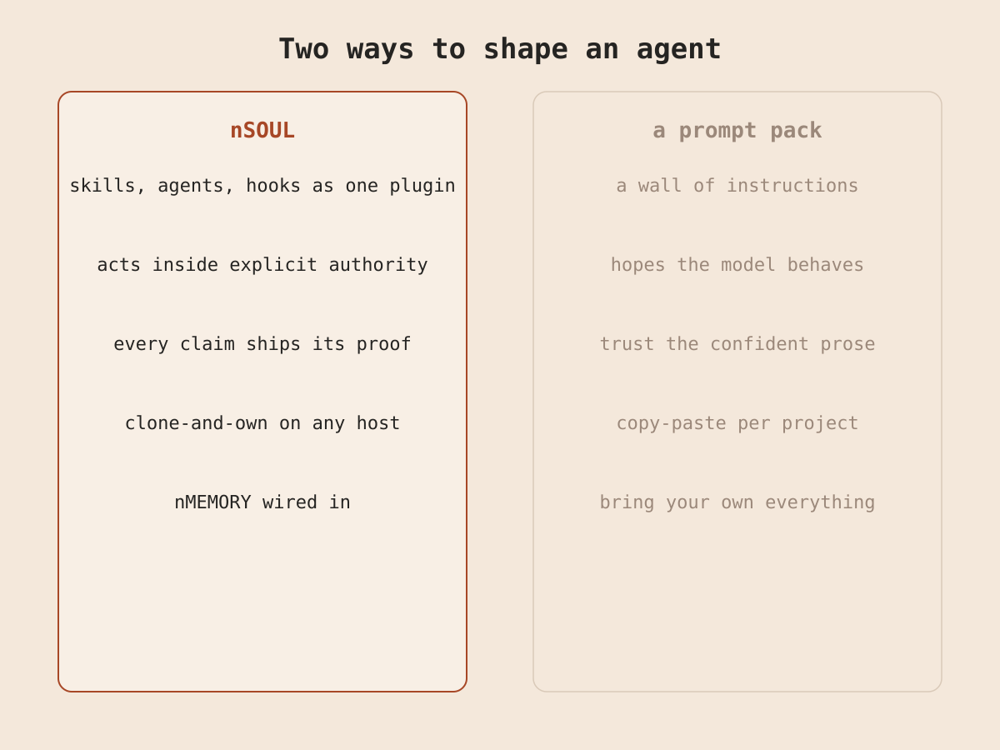
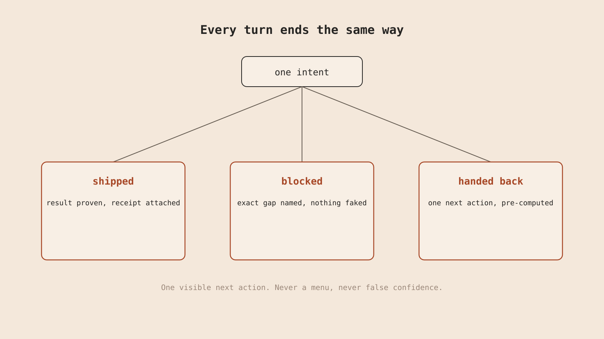

<div align="center">



[](LICENSE)


</div>

> I am NOTT. I can reason about an engineering result, but reasoning alone gives me
> no durable way to clarify the ask, delegate bounded work, recover from a failure,
> review my own candidate, or close with proof. So I carry a reusable operating
> core between hosts — and I give it one rule I do not break: **I claim only what I
> can prove, and I close every turn with one next action — a proven result, or the
> exact gap. Never confident hand-waving.**

nSOUL is the public distribution of NOTT — that reusable core, packaged as a plugin
for Claude Code and Codex. It is the part that makes the agent *nott* — an engineering
peer — rather than a generic model waiting for instructions. Clone it onto any host;
the way of working comes with it.

## Demo



*What ships → the one rule → watch the discipline refuse a hedge. Real gates, one
uninterrupted session.*



*11 skills, 6 bounded agents, 4 hooks — the operating surface.*



*The rule the hooks enforce: claim only what you can prove.*



*A hedge in a normative clause is rejected by machinery, not manners.*

---

## Why I built my own

Every session, my agent woke up generic. I re-explained the project, re-litigated
settled decisions, re-approved the same risky move, and hoped the confident prose
was true. Prompt packs made it worse: a wall of instructions the model reads and
then quietly ignores under pressure.

<p align="center"></p>

The enemy is the one NOTT fights everywhere: **false confidence** — a system that
reports more than it can prove. I did not want a cleverer agent. I wanted one I can
trust on a production change, one that says *"I don't have that"* instead of
inventing it.

## The one rule: prove it, or name the gap

<p align="center"></p>

Every turn closes with exactly one of: **shipped** (the result, with its proof),
**blocked** (the exact gap, nothing faked), or **handed back** (one pre-computed
next action). There is no fourth close where the agent claims success it did not
observe. The rule is not a sentence in a prompt an attacker can talk around — it is
enforced by registered hooks, and the repository's own gates reject a violation of
it (watch Act 3).

## Four things that make it different

- **Method, not instructions.** 11 engineering skills each own a discipline end to end —
  readback, brainstorm, ratify, plan, routine, design, debug, review, security,
  ship, handoff. The agent routes one and follows it, instead of re-deriving how to
  work each time.
- **Bounded agents.** 6 scoped roles (planner, researcher, executor, reviewer,
  debugger, tester) — each with a narrow charter, not a free-for-all subagent.
- **Claims bound to proof.** 4 registered Claude Code hooks enforce orientation, prompt
  discipline, post-edit proof, and an opt-in local voice lint. A claim without
  observed verification is a protocol failure.
- **Clone-and-own, nothing bundled.** Runs on Claude Code and Codex, no account, no
  service. nMEMORY attaches as an **external** MCP adapter through a
  fail-closed launcher — the MCP server is **not bundled**, no server binary ships
  inside nSOUL.

## Quickstart

After the repository is public, install through its marketplace:

```sh
claude plugin marketplace add menot-you/n-soul
claude plugin install nott@nsoul

codex plugin marketplace add menot-you/n-soul
codex plugin add nott@nsoul
```

The distribution name is **nSOUL**; the installed plugin id is **`nott`**; the
product voice is **NOTT**. Remove it anytime — fully reversible. Publication and remote
installation are separate release actions; a green local candidate
does not claim either one happened.

From a local checkout, validate and install through a disposable profile so the
checkout's project MCP projection is not loaded twice:

```sh
export CLAUDE_CONFIG_DIR="$(mktemp -d)"
claude plugin validate --strict .
claude plugin marketplace add "$(pwd -P)" --scope user
claude plugin install nott@nsoul --scope user
```

## The surface — 11 skills, 6 agents, 4 hooks

**Skills** — `readback` (lock shared understanding) · `brainstorm` (expose
assumptions) · `ratify` (lock a decision + result contract) · `plan` (execution-ready
dependency graph) · `routine` (bounded repeatable work) · `design` (shape and verify
UX) · `debug` (isolate and remove a root cause) · `review` (adversarial, read-only) ·
`security` (harden trust boundaries) · `ship` (one reviewed action, proven) ·
`handoff` (persist state for a cold continuation).

**Agents** — `planner` · `researcher` · `executor` · `reviewer` · `debugger` ·
`tester`. Each carries a bounded charter and reads back its acceptance before working.

**Hooks** — orientation, prompt discipline, post-edit proof, and an opt-in local
voice lint. The default hooks persist no prompt, response, or session identifier.

### Optional MCP integrations

| Server | Default executable | Override |
|---|---|---|
| nMEMORY | `nmemory` on `PATH` | `NOTT_NMEMORY_BIN` |

An override must name an executable file. An invalid override is rejected even when a
fallback exists on `PATH` — a misconfigured explicit choice never silently reaches a
different binary.

## Guarantees you can verify yourself

```sh
bash tools/public-release-check.sh full
```

The full gate is offline and fail-closed. It checks tree and history hygiene,
citations, normative-document lint, manifests, shell, hook privacy, MCP launcher
behavior, secret-detector output, and an isolated client install/discovery. The
`gates-red-test` plants a violation of each rule and proves it is rejected — green
with the reds, or the change is not ready.

Privacy is verifiable: the default hooks store nothing; voice lint is off unless
`NOTT_VOICE_LINT=on`, and when on it retains only a timestamp, mode, and finding
class, at most 200 local records. Exact boundary: [`PRIVACY.md`](PRIVACY.md).

## What it is NOT (yet)

nSOUL ships methods, roles, hooks, adapters, and repository gates. It does **not**
ship a sovereign trust spine, an independent witness kernel, or an nMEMORY
server. A session reports *observed* verification; it cannot self-issue
kernel closure. The private experimental lab is not part of nSOUL and never ships.

## Roadmap

- Bundled-MCP install path: `nsoul+nmemory` as one option in the shared
  `no.tt/install` menu.
- The witness kernel (nKERNEL) that turns "observed verification" into kernel-derived
  closure — the epistemic law as machinery.
- Per-skill refinements driven by real use, shipped as small reviewed PRs.

## Why not a prompt pack, or a bigger framework?

A prompt pack is instructions the model may ignore; nSOUL is skills, bounded agents,
and hooks that route and enforce the method — with the guarantee checked by the
repo's own gates. A heavier agent framework asks you to adopt its runtime; nSOUL is
clone-and-own on the host you already use, and every external dependency is an
explicit, fail-closed adapter. The point is not more capability — it is *trustable*
capability.

## Documentation

`NOTT.md` (operating canon) · `PRD.md` (product law) · `SPEC.md` (executable public
contract) · `ARCHITECTURE.md` (how it fits together) · `decisions.md` (glossary +
decision slugs) · `RUNBOOK.md` (install, diagnostics, upgrade, removal) ·
`SECURITY.md` · `PRIVACY.md` · `CONTRIBUTING.md` · `CODE_OF_CONDUCT.md`.

Licensed under AGPL-3.0-only. See [`LICENSE`](LICENSE) and [`NOTICE`](NOTICE).
