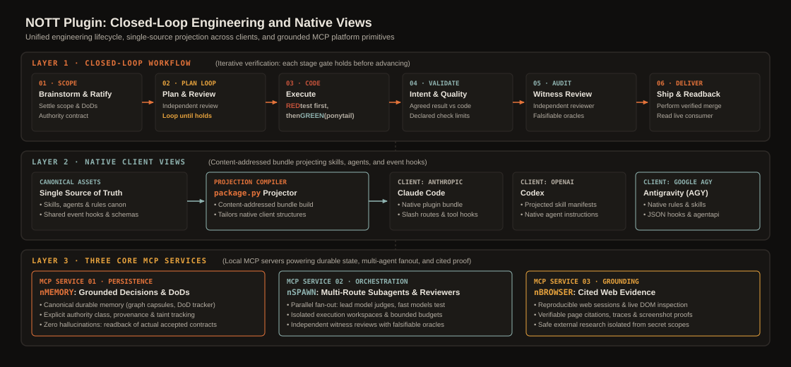
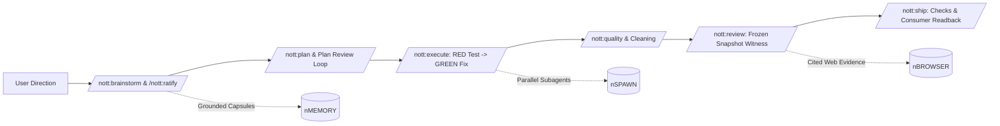
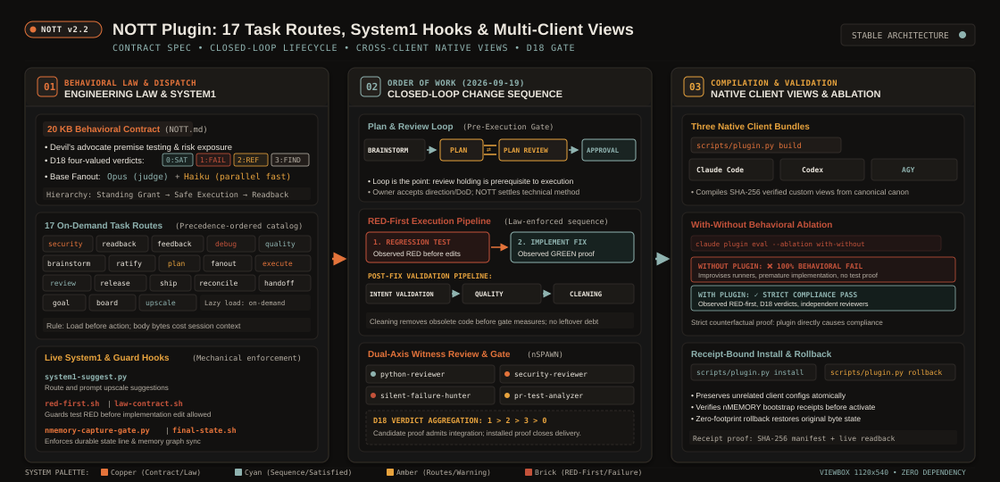
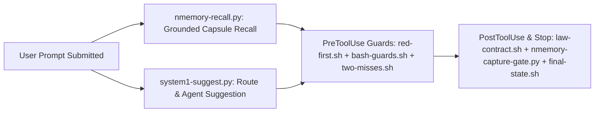

# NOTT plugin


**Turn an AI coding client into a disciplined software engineering team with grounded memory, System1 hooks, and independent witness reviews.**
The `NOTT` plugin gives Claude Code, Codex, and AGY one engineering law (`NOTT.md`), **18 on-demand workflow routes** (`skills/`), and **5 specialized review agents** (`agents/`).
It connects native client hooks (`hooks/`) with `nMEMORY`, `nSPAWN`, and `nBROWSER`.

---

## Why the NOTT plugin exists

Unstructured agent sessions edit code without past decisions, skip regression tests, review their own diffs, and lose state across compactions.

| Without the NOTT plugin | With the NOTT plugin |
| --- | --- |
| Sessions forget earlier architectural decisions and repeat rejected approaches. | `SessionStart` and `UserPromptSubmit` hooks recover grounded decisions and open work from `nMEMORY`. |
| Agents write fixes first and write tests later (or not at all). | The `red-first.sh` hook and `/nott:execute` route require a failing regression test (`RED`) before product edits (`GREEN`). |
| Vague prompts waste tokens on the wrong scope. | The System1 hook `system1-suggest.py` suggests prompt upscales. |
| One agent writes and self-approves its own pull request. | `/nott:review` freezes a snapshot and dispatches an independent read-only witness through `nSPAWN`. |
| Shell mistakes can force-push to `main`, kill unrelated processes, or leak secrets. | `bash-guards.sh` and `secret-in-output.sh` enforce least-privilege boundaries on every tool call. |

---

## System anatomy and closed-loop workflow



Every repository change moves through a clear, evidence-backed sequence where independent units advance in parallel as soon as their inputs are ready:



---

## Standout technical features



### 1. 20 KB engineering law (`NOTT.md`) and 18 on-demand routes (`skills/`)

Loading every procedure into every prompt bloats context and degrades instruction following.
The plugin keeps universal judgment in `NOTT.md` (strictly capped at 20,000 bytes) and loads task-specific routes only when that kind of work starts:

- **Devil's-advocate premise testing:** challenges hidden costs and flawed premises with evidence before implementation starts.
- **Four-valued D18 verdicts (`0 / 1 / 2 / 3`):** distinguishes `0` (satisfied), `1` (operational/provider failure), `2` (refused or inconclusive proof), and `3` (observed defect), aggregating `1 > 2 > 3 > 0`.
- **Opus + Haiku base fanout method (`/nott:fanout`):** pairs a strong decision model with parallel fast subagents across independent work units.

### 2. Live System1 hooks (`Laya` / `Jev` and local SLMs) and runtime guards

The plugin uses `nott-system1` (`laya-nott` over `/v1/systemone` or a local loopback `/v1/chat/completions` SLM) alongside deterministic shell/Python guards:



- **RED-first enforcement (`red-first.sh`):** blocks product code edits on behavior changes until a regression check runs and fails (`RED`).
- **Two-miss suspension (`two-misses.sh`):** tracks repeated failures on the same proof path. After two misses without new evidence, it switches the session to causal diagnosis (`/nott:debug`).
- **System1 prompt suggestion (`system1-suggest.py`):** queries System1 with typed probabilistic questions (`noul` and `choice`) to recommend routes. The hook fails open when System1 is offline.
- **Memory capture gate (`nmemory-capture-gate.py`):** checks at turn end that the session persisted user decisions and corrections in `nMEMORY`.

### 3. Frozen-snapshot independent witness review (`/nott:review`)

Self-review is not an enforcement boundary.
When `/nott:review` runs:

1. `scripts/review.sh snapshot` copies the candidate commit and diff into an immutable, `.git`-free snapshot directory (`.nott-review-sha` + `.nott-review-diff`).
2. `nSPAWN` starts a caged read-only reviewer session on an independent route with zero shared conversation history.
3. Five specialized review agents inspect the diff by domain: `nott:python-reviewer`, `nott:swift-reviewer`, `nott:security-reviewer`, `nott:silent-failure-hunter`, and `nott:pr-test-analyzer`.

### 4. Content-addressed multi-client views and `--ablation with-without` evaluation

- **Three native client bundles:** `scripts/plugin.py build` compiles `NOTT.md`, `skills/`, `agents/`, and `hooks/` into content-addressed views for `clients/claude`, `clients/codex`, and `clients/agy`. It maps each hook only where the target client supports its event payload.
- **With-without behavioral ablation (`evals/native/`):** a behavioral test case enters the suite only after it fails without the plugin and passes with the plugin (`--ablation with-without`).

---

## Quickstart in 60 seconds

### 1. Build and check a self-contained bundle from source

Use an approved source checkout or archive. Run from its repository root:

```bash
uv sync --group dev
python3 scripts/plugin.py build --source "$PWD" --output "$PWD/.nott/bundles/first" --runtime-root "$PWD/.venv"
python3 scripts/plugin.py verify "$PWD/.nott/bundles/first"
python3 scripts/plugin.py show
```

Use a new output directory when the source changes.
The [runbook](docs/RUNBOOK.md) covers native activation, receipt-bound installation, and rollback.
The [installation guide](docs/INSTALLATION.md) separates prerequisites from processing choices.
A source build does not prove that a native client loaded the plugin.

### 2. Run your first closed-loop session

1. Give the client one bounded synthetic-file change and an observable result.
2. Ask it to recover project context from `nMEMORY`, write the failing regression check first (`RED`), implement the fix (`GREEN`), and report the focused proof.
3. Start a second session and ask for the recorded decision and remaining work.
4. Check the loaded MCP catalog before relying on memory or dispatch.

---

## Workflow routes and native clients

The plugin packages **18 workflow routes** and **5 read-only review agents** (`nott:python-reviewer`, `nott:swift-reviewer`, `nott:security-reviewer`, `nott:silent-failure-hunter`, `nott:pr-test-analyzer`):

| Stage | Routes | What it governs |
| --- | --- | --- |
| **Direction and discovery** | `/nott:goal`, `/nott:readback`, `/nott:brainstorm`, `/nott:ratify` | Clarify the target outcome, test premises with evidence, and persist ratified decisions in `nMEMORY`. |
| **Planning and fanout** | `/nott:plan`, `/nott:fanout`, `/nott:board`, `/nott:upscale` | Decompose work into independent units, deepen briefs with raw source material, bind Definitions of Done, and fan out workers through `nSPAWN`. |
| **Execution and debugging** | `/nott:execute`, `/nott:debug`, `/nott:quality`, `/nott:security` | Enforce RED-first regression tests, two-miss causal diagnosis, and repository quality floors. |
| **Review and delivery** | `/nott:review`, `/nott:ship`, `/nott:release`, `/nott:reconcile`, `/nott:handoff`, `/nott:feedback` | Freeze candidate snapshots for independent review, check live consumers, and preserve cold-readable state across handoffs. |

### Clients and dependencies

| Client | Source view | Evidence limit |
| --- | --- | --- |
| Claude Code | Native plugin and native hook events | The behavioral evaluation host |
| Codex | Native plugin, MCP, and hook bindings | Install smoke does not prove behavioral parity |
| AGY | Generated customization view | Hook payload limits apply, new nSPAWN sessions remain refused |

The full plugin needs nMEMORY, nSPAWN, and nBROWSER.
Native clients need their own authentication.
Browser operations need the declared engine and host facilities.
Web search and semantic code search remain optional integrations with separate credentials.
The plugin supplies no account, subscription, browser binary, or index credential.

---

## Test and check locally

Run the packager, installer, and public document checks in isolated temporary directories:

```bash
TMPDIR=/var/tmp uv run --group dev pytest tests/test_public_documents.py tests/test_package_plugin.py -q
uv run ruff check .
```

---

## Try it, give feedback, and contribute

We built the `NOTT` plugin for engineers who want their AI coding client to work like a disciplined software team.

- **Try it on your repository:** install the bundle into Claude Code or Codex in a disposable project. Run a `/nott:plan` and `/nott:execute` cycle and inspect how the hooks guard each step.
- **Share feedback and bug reports:** open an issue if a hook blocks a valid command or a route instruction is unclear. Include the event payload and client version.
- **Send a first contribution:** start with the [documentation index](docs/README.md) for a guided first change. Read [CLAUDE.md](https://github.com/menot-you/plugin/blob/main/CLAUDE.md), configure your environment with [setup](https://github.com/menot-you/plugin/blob/main/docs/SETUP.md), and run the checks in [quality](https://github.com/menot-you/plugin/blob/main/docs/QUALITY.md).

## Read and contribute

| Need | Page |
| --- | --- |
| Agent and contributor contract | [CLAUDE.md](https://github.com/menot-you/plugin/blob/main/CLAUDE.md) |
| Contributor development setup | [Setup](https://github.com/menot-you/plugin/blob/main/docs/SETUP.md) |
| Checks and security review | [Quality](https://github.com/menot-you/plugin/blob/main/docs/QUALITY.md) |
| Documentation index and first contribution | [Docs](docs/README.md) |
| Setup, operation, backup, and restoration | [Runbook](docs/RUNBOOK.md) |
| Workflow and the three MCP services | [Architecture](docs/ARCHITECTURE.md) |
| Packaging, tools, and CLI commands | [Reference](docs/REFERENCE.md) |
| Installation | [Installation](docs/INSTALLATION.md) |
| Processing choices | [Privacy](docs/PRIVACY.md) |
| Existing activation or data | [Upgrade](docs/UPGRADE.md) |
| Failure diagnosis | [Troubleshooting](docs/TROUBLESHOOTING.md) |
| Direction | [Roadmap](docs/ROADMAP.md) |
| Changes | [Changelog](CHANGELOG.md) |

Read [contributing](CONTRIBUTING.md), [conduct](CODE_OF_CONDUCT.md), and [support](SUPPORT.md).
Report sensitive issues through [security](SECURITY.md).
See [license](LICENSE) and [citation](CITATION.cff).

## Native hook coverage

A hook request alone does not prove that a client enforced a boundary.
Claude uses its native event payloads.
Codex has different shell and edit bindings. The host must enable and trust its hooks.
AGY `PreInvocation` can inject an ephemeral message.
AGY `PostToolUse` supplies no guaranteed tool arguments and must return `{}`.
Its advisory feedback arrives on a later invocation.
This table makes no claim of equal behavior across clients.

The table comes from `python3 scripts/plugin.py show`.
`unproven` means that the view smoke does not exercise that binding.
The table describes the source view. Public bundle filtering can remove source-only bindings.
Inspect the final bundle and the native client's loaded catalog for the installed view.

<details>
<summary>Inspect the complete native hook matrix</summary>

<!-- nott:client-matrix:start -->
| client | hook script | event | route | proof | not loaded because |
| --- | --- | --- | --- | --- | --- |
| claude | pynott-branch-lock.sh | PreToolUse | verbatim | unproven |  |
| claude | bash-guards.sh | PreToolUse | verbatim | unproven |  |
| claude | two-misses.sh | PreToolUse | verbatim | unproven |  |
| claude | campaign-pr-guard.py | PreToolUse | verbatim | unproven |  |
| claude | plan-exit-gate.sh | PreToolUse | verbatim | unproven |  |
| claude | dispatch-tier.py | PreToolUse | verbatim | unproven |  |
| claude | nmemory-main-only.py | PreToolUse | verbatim | unproven |  |
| claude | red-first.sh | PreToolUse | verbatim | unproven |  |
| claude | session-state.sh | PreToolUse | verbatim | unproven |  |
| claude | law-contract.sh | PostToolUse | verbatim | unproven |  |
| claude | nmemory-anchor-queue.sh | PostToolUse | verbatim | unproven |  |
| claude | nspawn-pairing.sh | PostToolUse | verbatim | unproven |  |
| claude | nmemory-act.py | PostToolUse | verbatim | unproven |  |
| claude | bash-guard.py | PostToolUse | verbatim | unproven |  |
| claude | red-first.sh | PostToolUse | verbatim | unproven |  |
| claude | two-misses.sh | PostToolUse | verbatim | unproven |  |
| claude | secret-in-output.sh | PostToolUse | verbatim | unproven |  |
| claude | session-state.sh | PostToolUse | verbatim | unproven |  |
| claude | artifact-copy.py | PostToolUse | verbatim | unproven |  |
| claude | secret-in-output.sh | PostToolUseFailure | verbatim | unproven |  |
| claude | red-first.sh | PostToolUseFailure | verbatim | unproven |  |
| claude | two-misses.sh | PostToolUseFailure | verbatim | unproven |  |
| claude | session-state.sh | PostToolUseFailure | verbatim | unproven |  |
| claude | law-session.sh | SessionStart | verbatim | unproven |  |
| claude | law-session.sh | SessionStart | verbatim | unproven |  |
| claude | law-session.sh | SessionStart | verbatim | unproven |  |
| claude | nmemory-session.sh | SessionStart | verbatim | unproven |  |
| claude | nmemory-session.sh | SessionStart | verbatim | unproven |  |
| claude | nmemory-act.py | SessionStart | verbatim | unproven |  |
| claude | nspawn-child-directives.sh | SessionStart | verbatim | unproven |  |
| claude | nspawn-notices.sh | SessionStart | verbatim | unproven |  |
| claude | session-state.sh | SessionStart | verbatim | unproven |  |
| claude | session-state.sh | Notification | verbatim | unproven |  |
| claude | nmemory-snapshot.sh | SessionEnd | verbatim | unproven |  |
| claude | nmemory-snapshot.sh | PreCompact | verbatim | unproven |  |
| claude | nmemory-snapshot.sh | PostCompact | verbatim | unproven |  |
| claude | final-state.sh | Stop | verbatim | unproven |  |
| claude | session-state.sh | Stop | verbatim | unproven |  |
| claude | nmemory-capture-gate.py | Stop | verbatim | unproven |  |
| claude | session-state.sh | UserPromptSubmit | verbatim | unproven |  |
| claude | fanout-reminder.sh | UserPromptSubmit | verbatim | unproven |  |
| claude | final-state.sh | UserPromptSubmit | verbatim | unproven |  |
| claude | system1-suggest.py | UserPromptSubmit | verbatim | unproven |  |
| claude | nmemory-recall.py | UserPromptSubmit | verbatim | unproven |  |
| claude | nmemory-act.py | UserPromptSubmit | verbatim | unproven |  |
| claude | subagent-law.py | SubagentStart | verbatim | unproven |  |
| claude | session-state.sh | SubagentStop | verbatim | unproven |  |
| claude | session-state.sh | TeammateIdle | verbatim | unproven |  |
| claude | session-state.sh | StopFailure | verbatim | unproven |  |
| codex | pynott-branch-lock.sh | PreToolUse | codex pre-shell | unproven |  |
| codex | bash-guards.sh | PreToolUse | codex pre-shell | bash-guards |  |
| codex | two-misses.sh | PreToolUse | codex pre-shell | two-misses |  |
| codex | campaign-pr-guard.py | PreToolUse | codex pre-shell | unproven |  |
| codex | plan-exit-gate.sh | PreToolUse | not projected |  | Codex has no ExitPlanMode tool, so neither half of the plan gate has an event to hang on |
| codex | dispatch-tier.py | PreToolUse | not projected |  | binds the Claude Agent tool, which Codex does not have |
| codex | nmemory-main-only.py | PreToolUse | not projected |  | it denies a Claude subagent by the agent_id of a Claude payload. On Codex only an nSPAWN child is covered: nMEMORY refuses it by NOTT_NSPAWN_RUN_ID, which nSPAWN forwards. A Codex multi_agent sub-agent is not covered |
| codex | red-first.sh | PreToolUse | codex pre-shell | red-first |  |
| codex | session-state.sh | PreToolUse | codex session-state-pre | session-state |  |
| codex | law-contract.sh | PostToolUse | not projected |  | Claude runs it on PostToolUse Write\|Edit\|MultiEdit; the Codex post-edit advisory names the contract and does not run it |
| codex | nmemory-anchor-queue.sh | PostToolUse | not projected |  | enqueues the EDITED path from a Claude Write\|Edit payload (tool_input.file_path); Codex writes by piping a patch into apply_patch from the shell tool, so post-edit sees patch text, not a path, and has no codex-hook-runner.py action for it |
| codex | nspawn-pairing.sh | PostToolUse | not projected |  | reads a Claude payload shape and has no codex-hook-runner.py action; Codex serves the event, the handler is not projected |
| codex | nmemory-act.py | PostToolUse | not projected |  | its act is a Claude dispatch tool on PostToolUse, which Codex runs only through runner actions, so a turn start or a compaction here would have no act to reach |
| codex | bash-guard.py | PostToolUse | not projected |  | reads a Claude payload shape and has no codex-hook-runner.py action; Codex serves the event, the handler is not projected |
| codex | red-first.sh | PostToolUse | codex post-edit | red-first-tested |  |
| codex | two-misses.sh | PostToolUse | codex post-edit | two-misses |  |
| codex | secret-in-output.sh | PostToolUse | codex post-edit | secret-output |  |
| codex | session-state.sh | PostToolUse | codex session-state-post | session-state |  |
| codex | artifact-copy.py | PostToolUse | not projected |  | binds the Claude Artifact tool, which Codex does not have |
| codex | secret-in-output.sh | PostToolUseFailure | not projected |  | Codex has no such event. Both Claude handlers (secret-in-output's chain advisory, red-first's `tested` record) ride post-edit on PostToolUse, which Codex runs after a non-zero Bash exit too (measured 2026-09-14, #444) |
| codex | red-first.sh | PostToolUseFailure | not projected |  | Codex has no such event. Both Claude handlers (secret-in-output's chain advisory, red-first's `tested` record) ride post-edit on PostToolUse, which Codex runs after a non-zero Bash exit too (measured 2026-09-14, #444) |
| codex | two-misses.sh | PostToolUseFailure | not projected |  | Codex has no such event. Both Claude handlers (secret-in-output's chain advisory, red-first's `tested` record) ride post-edit on PostToolUse, which Codex runs after a non-zero Bash exit too (measured 2026-09-14, #444) |
| codex | session-state.sh | PostToolUseFailure | not projected |  | Codex has no such event. Both Claude handlers (secret-in-output's chain advisory, red-first's `tested` record) ride post-edit on PostToolUse, which Codex runs after a non-zero Bash exit too (measured 2026-09-14, #444) |
| codex | law-session.sh | SessionStart | verbatim | unproven |  |
| codex | law-session.sh | SessionStart | verbatim | unproven |  |
| codex | law-session.sh | SessionStart | verbatim | unproven |  |
| codex | nmemory-session.sh | SessionStart | verbatim | unproven |  |
| codex | nmemory-session.sh | SessionStart | verbatim | unproven |  |
| codex | nmemory-act.py | SessionStart | not projected |  | its act is a Claude dispatch tool on PostToolUse, which Codex runs only through runner actions, so a turn start or a compaction here would have no act to reach |
| codex | nspawn-child-directives.sh | SessionStart | verbatim | unproven |  |
| codex | nspawn-notices.sh | SessionStart | not projected |  | the nSPAWN notice drain is at-most-once and only a Claude Code session is a notice caller; draining here would take the notice the project's next Claude session is owed |
| codex | session-state.sh | SessionStart | verbatim | unproven |  |
| codex | session-state.sh | Notification | not projected |  | The Codex view has no native permission notification binding. Waiting tools use PreToolUse. |
| codex | nmemory-snapshot.sh | SessionEnd | verbatim | unproven |  |
| codex | nmemory-snapshot.sh | PreCompact | verbatim | unproven |  |
| codex | nmemory-snapshot.sh | PostCompact | verbatim | unproven |  |
| codex | final-state.sh | Stop | codex stop | voice |  |
| codex | session-state.sh | Stop | codex stop | session-state |  |
| codex | nmemory-capture-gate.py | Stop | codex stop | capture-gate |  |
| codex | session-state.sh | UserPromptSubmit | verbatim | unproven |  |
| codex | fanout-reminder.sh | UserPromptSubmit | verbatim | unproven |  |
| codex | final-state.sh | UserPromptSubmit | verbatim | unproven |  |
| codex | system1-suggest.py | UserPromptSubmit | not projected |  | its catalog is the Claude agent types under ~/.claude and the routes as Claude names them; a Codex session has neither that Agent tool nor those names |
| codex | nmemory-recall.py | UserPromptSubmit | verbatim | unproven |  |
| codex | nmemory-act.py | UserPromptSubmit | not projected |  | its act is a Claude dispatch tool on PostToolUse, which Codex runs only through runner actions, so a turn start or a compaction here would have no act to reach |
| codex | subagent-law.py | SubagentStart | not projected |  | Codex has no subagent events; the subagent law reaches Claude subagents only |
| codex | session-state.sh | SubagentStop | not projected |  | Codex has no subagent events; session-state.sh's dead[] record hangs on SubagentStop |
| codex | session-state.sh | TeammateIdle | not projected |  | Codex has no teams and no TeammateIdle event |
| codex | session-state.sh | StopFailure | not projected |  | Codex has no StopFailure event; a dead session is not announced there |
| agy | pynott-branch-lock.sh | PreToolUse | agy pre-tool-run-command | unproven |  |
| agy | bash-guards.sh | PreToolUse | agy pre-tool-run-command | bash-guards |  |
| agy | two-misses.sh | PreToolUse | not projected |  | its ledger fills from the command text after the run, which AGY's PostToolUse payload lacks, so its PreToolUse deny would never fire |
| agy | campaign-pr-guard.py | PreToolUse | agy pre-tool-run-command | unproven |  |
| agy | plan-exit-gate.sh | PreToolUse | not projected |  | AGY has no ExitPlanMode tool, so neither half of the plan gate has an event to hang on |
| agy | dispatch-tier.py | PreToolUse | not projected |  | binds the Claude Agent tool, which AGY does not have |
| agy | nmemory-main-only.py | PreToolUse | not projected |  | it denies a Claude subagent by the agent_id of a Claude payload; AGY has no subagent events. nMEMORY refuses an AGY nSPAWN child when its MCP server inherits NOTT_NSPAWN_RUN_ID (not measured) |
| agy | red-first.sh | PreToolUse | not projected |  | both halves: its `tested` record needs the command text after the run, and AGY's PostToolUse payload is {stepIdx, error, ...common} (agy-customizations docs/hooks.md), so the deny half would call a tested session untested |
| agy | session-state.sh | PreToolUse | not projected |  | surface of the Claude statusline; AGY has no statusline and no subagent events, so a phase file would have no reader |
| agy | law-contract.sh | PostToolUse | agy post-tool-write | law-contract |  |
| agy | nmemory-anchor-queue.sh | PostToolUse | not projected |  | enqueues the EDITED path from a Claude Write\|Edit payload (tool_input.file_path); AGY's PostToolUse payload is {stepIdx, error, ...common} with no path, so there is nothing to enqueue |
| agy | nspawn-pairing.sh | PostToolUse | not projected |  | reads a Claude MCP tool payload; AGY has no agy-hook-runner.py action for it |
| agy | nmemory-act.py | PostToolUse | not projected |  | AGY's PostToolUse payload is {stepIdx, error, ...common}, with no tool name or input, so no act can be matched |
| agy | bash-guard.py | PostToolUse | not projected |  | reads a Claude payload shape (tool_response) that AGY's PostToolUse does not carry |
| agy | red-first.sh | PostToolUse | not projected |  | both halves: its `tested` record needs the command text after the run, and AGY's PostToolUse payload is {stepIdx, error, ...common} (agy-customizations docs/hooks.md), so the deny half would call a tested session untested |
| agy | two-misses.sh | PostToolUse | not projected |  | its ledger fills from the command text after the run, which AGY's PostToolUse payload lacks, so its PreToolUse deny would never fire |
| agy | secret-in-output.sh | PostToolUse | not projected |  | no output text in AGY's PostToolUse payload |
| agy | session-state.sh | PostToolUse | not projected |  | surface of the Claude statusline; AGY has no statusline and no subagent events, so a phase file would have no reader |
| agy | artifact-copy.py | PostToolUse | not projected |  | binds the Claude Artifact tool, which AGY does not have |
| agy | secret-in-output.sh | PostToolUseFailure | not projected |  | AGY has no such event; its PostToolUse payload carries {stepIdx, error} and post-tool-run-command names the error in its advisory |
| agy | red-first.sh | PostToolUseFailure | not projected |  | AGY has no such event; its PostToolUse payload carries {stepIdx, error} and post-tool-run-command names the error in its advisory |
| agy | two-misses.sh | PostToolUseFailure | not projected |  | AGY has no such event; its PostToolUse payload carries {stepIdx, error} and post-tool-run-command names the error in its advisory |
| agy | session-state.sh | PostToolUseFailure | not projected |  | AGY has no such event; its PostToolUse payload carries {stepIdx, error} and post-tool-run-command names the error in its advisory |
| agy | law-session.sh | SessionStart | not projected |  | AGY reads the law from rules/AGENTS.md (a link to NOTT.md) at startup; injecting it again at pre-invocation would double it |
| agy | law-session.sh | SessionStart | not projected |  | AGY reads the law from rules/AGENTS.md (a link to NOTT.md) at startup; injecting it again at pre-invocation would double it |
| agy | law-session.sh | SessionStart | not projected |  | AGY reads the law from rules/AGENTS.md (a link to NOTT.md) at startup; injecting it again at pre-invocation would double it |
| agy | nmemory-session.sh | SessionStart | not projected |  | reads a Claude SessionStart payload (source, transcript_path); pre-invocation injects its own nMEMORY directive on the first invocation instead |
| agy | nmemory-session.sh | SessionStart | not projected |  | reads a Claude SessionStart payload (source, transcript_path); pre-invocation injects its own nMEMORY directive on the first invocation instead |
| agy | nmemory-act.py | SessionStart | not projected |  | AGY's PostToolUse payload is {stepIdx, error, ...common}, with no tool name or input, so no act can be matched |
| agy | nspawn-child-directives.sh | SessionStart | agy pre-invocation | child-directives |  |
| agy | nspawn-notices.sh | SessionStart | not projected |  | the nSPAWN notice drain is at-most-once and only a Claude Code session is a notice caller; draining here would take the notice the project's next Claude session is owed |
| agy | session-state.sh | SessionStart | not projected |  | surface of the Claude statusline; AGY has no statusline and no subagent events, so a phase file would have no reader |
| agy | session-state.sh | Notification | not projected |  | AGY has no native permission notification in this view |
| agy | nmemory-snapshot.sh | SessionEnd | not projected |  | AGY's hooks.md offers PreInvocation, PreToolUse, PostToolUse, PostInvocation and Stop; there is no SessionEnd |
| agy | nmemory-snapshot.sh | PreCompact | not projected |  | AGY's hooks.md offers PreInvocation, PreToolUse, PostToolUse, PostInvocation and Stop; there is no PreCompact |
| agy | nmemory-snapshot.sh | PostCompact | not projected |  | AGY's hooks.md offers PreInvocation, PreToolUse, PostToolUse, PostInvocation and Stop; there is no PostCompact |
| agy | final-state.sh | Stop | agy stop | voice |  |
| agy | session-state.sh | Stop | not projected |  | surface of the Claude statusline; AGY has no statusline and no subagent events, so a phase file would have no reader |
| agy | nmemory-capture-gate.py | Stop | not projected |  | reads the current turn's Claude transcript JSONL (tool_use and tool_result blocks for nmemory_capsule_ingest). This view does not supply that transcript protocol |
| agy | session-state.sh | UserPromptSubmit | not projected |  | surface of the Claude statusline; AGY has no statusline and no subagent events, so a phase file would have no reader |
| agy | fanout-reminder.sh | UserPromptSubmit | not projected |  | AGY has no UserPromptSubmit, and a worker's completion never reaches it as a Claude <task-notification> or nSPAWN supervisor notice |
| agy | final-state.sh | UserPromptSubmit | not projected |  | AGY has no UserPromptSubmit to carry the voice advice, and its stop action runs this script for the voice check alone (NOTT_HOOK_CLIENT=agy): AGY has no statusline for a state line |
| agy | system1-suggest.py | UserPromptSubmit | not projected |  | AGY has no UserPromptSubmit, the only event the suggestion rides |
| agy | nmemory-recall.py | UserPromptSubmit | not projected |  | AGY has no UserPromptSubmit, the only event the recall rides |
| agy | nmemory-act.py | UserPromptSubmit | not projected |  | AGY's PostToolUse payload is {stepIdx, error, ...common}, with no tool name or input, so no act can be matched |
| agy | subagent-law.py | SubagentStart | not projected |  | AGY's hooks.md offers PreInvocation, PreToolUse, PostToolUse, PostInvocation and Stop; there is no SubagentStart |
| agy | session-state.sh | SubagentStop | not projected |  | AGY's hooks.md offers PreInvocation, PreToolUse, PostToolUse, PostInvocation and Stop; there is no SubagentStop |
| agy | session-state.sh | TeammateIdle | not projected |  | AGY's hooks.md offers PreInvocation, PreToolUse, PostToolUse, PostInvocation and Stop; there is no TeammateIdle |
| agy | session-state.sh | StopFailure | not projected |  | AGY's hooks.md offers PreInvocation, PreToolUse, PostToolUse, PostInvocation and Stop; there is no StopFailure |
<!-- nott:client-matrix:end -->

</details>

## Implementation contract

This section keeps the private tree's contract text beside the public overview.

The default tool recipe is `plugin/toolset.toml`, schema 1. It has one `source`
table per origin and one `tool` row per tool. Internal sources have only
`kind = "release"`: they come from the release that ships this recipe.
External sources have `kind`, `url` and `pin`. Git sources use a full commit.
Binary and npm sources use an exact version. A binary source also requires
`installer_sha256`, which pins the installer at its URL. An npm source requires
`integrity`, the registry's `dist.integrity` value with a SHA512 digest.
Each tool has `name`, `source`, `install.step`, `check.kind`,
`check.target`, `login.kind`, `login.step`, `clients` and `load`. Callback
logins also have `login.forward`. Install steps that refer to `source.pin` use
the pin in their source table.

Git skill install recipes also have `install.path`. This relative path selects
the skill inside the checked commit. `.` selects the source root. Absolute
paths, parent paths and linked files refuse. The full Git commit is both pin
and digest. The host checks HEAD before any copy.

`nott tool install <id>` uses these typed fields. It never evaluates
`install.step` as shell code. Git recipes use the checked skill copy. The
jbcontext recipe uses its checked installer with `--version=<pin>`. The REA recipe
packs its exact version, checks SHA512, installs the checked local tarball,
then uses its owning setup for the shared skill. npm package scripts remain
disabled. Internal release rows have no separate pin or digest. Their running
release and its build check bind them. The command only reports their status.
`apps/cli/README.md` defines the command's output and exits.

The CLI release ships this file beside its MCP configuration. `nott tool list`
reads it through the trusted release root and adds current local status.
The manifest does not register or start tools. It does not change native
client load behavior. `apps/cli/README.md` defines the status results.

The jbcontext login uses a local HTTP callback with PKCE. Its native
0.9.15.969 binary ran in an isolated home on SERVER. It emitted a
JetBrains OAuth request with a loopback redirect and a variable port. It did
not offer a device code. A Mac browser needs port forwarding before login.
This command does not start login or open a browser.

From the repository root:

The `nott-node` question server requires Claude Code's terminal answer socket.
Only the `clients/claude` view registers it. Node views use the host's bound bridge.

The `nott` MCP directory and repository-scoped hooks bind to `--runtime-root`.
Other MCP registrations preserve executable names, arguments and environment
**names**, including `nmemory`'s `OPENAI_API_KEY`; credentials are never read or
copied by the builder. An evaluation may replace native MCP configuration with
isolated fixtures only when that effective projection is separately recorded.

The entry's `source` is `./plugin`; at install time the version in
`plugin/.claude-plugin/plugin.json` wins over the entry's, so the two must agree
— the validator warns when they do not and `--strict` turns that warning into
exit 1. The marketplace therefore installs `./plugin` **from the repository**,
never the content-addressed bundle, whose view declares `0.1.<N>+sha.<digest>`:
`N` is the packaged commit's committer time (Unix seconds), so a later release
sorts above every version a client already cached. The order is guaranteed along
main's merge history only; a branch build must never be installed into a shared
cache. Two commits in the same second fall back to the digest, and a skewed clock
can invert the order.
This repository ships **no Codex marketplace manifest**: register the generated
`clients/codex` view through that client's own install command.

### Deliver into the live tree

Claude Code sessions on the host load the plugin from `<checkout>/plugin`
(`--plugin-dir`). That checkout holds uncommitted work of other agents, so a
pull cannot move it. A merged plugin change goes in with this command:

```bash
python3 plugin/scripts/plugin.py deliver <commit> <checkout>
```

The command compares each file of the commit's `plugin/` with the checkout, by
bytes and execute bit. It writes only the files that differ. Each delivery
records its commit in the ref `refs/worktree/nott/plugin-delivered` of the
checkout. The ref moves no branch, `HEAD` or index, and each worktree has its
own. The base of each file is its version in that commit:

- A file with the bytes of its base version, or absent in the base and in the
  checkout, has no local edit. The command gives it the version of the commit.
  It also gives the mode of the commit to a file with the bytes of the commit.
- A file with other bytes has a local edit, for example a rollback. The command
  keeps it and lists it under `kept`. If the commit changes the file, the
  command stops.
- A local edit of a `hooks.json` gets a three-way merge of the edit, its base
  version and the version of the commit. So the edit stays and the changes of
  the commit arrive. The command lists the file under `merged`.
- A file that the base has and the commit does not have stays. The command
  lists it under `removed`.

The output lists the bases under `bases`. Under `matched`, it names the commit
whose version each written or merged file had.

A checkout without the ref needs the commits that its files came from. Give
each one with `--base`:

```bash
python3 plugin/scripts/plugin.py deliver <commit> <checkout> \
  --base <commit> --base <commit>
```

Then a file with the bytes of one of these versions has no local edit. The
first `--base` is the base of a merge and of the check for a changed local edit.
The command refuses `--base` when the ref is there.

The command writes nothing and exits 2 in these cases:

- A hook that a `hooks.json` command names is not executable in the commit, or
  is not executable after the delivery.
- A file or a link is where the commit has a directory, or a directory is where
  the commit has a file.
- The commit changes a file that has a local edit.
- The local edit of a `hooks.json` and the commit change the same lines, or the
  merge gives a key twice.
- The checkout has no ref and no `--base`, and a file differs from the commit
  in its bytes. The command names the files.
- The ref is there and the command line has `--base`, or the ref or a `--base`
  is not a commit.

The command extracts the commit with `git archive` into `.nott/deliver/` of the
checkout, on the file system of `plugin/`, and compares each extracted file with
the commit. It copies each file that it replaces into the backup directory
there. Then it moves each new file into place with `os.replace`, so a session
reads the old file or the new file, never a part of one. The `hooks.json` files
move last. Then the command reads back each written file and moves the ref to
the commit. On a failure it moves every file back, does not move the ref and
exits 1. A killed run leaves each file whole, and its backup stays in its own
directory under `.nott/deliver/`: run the command again to complete the
delivery. The output names the backup directory. To undo a delivery, deliver
the earlier commit. The files that only the newer commit has stay, and the
output lists them under `removed`.

Do not copy plugin bytes by hand. A byte copy
(`git show <commit>:<path> > <path>`) does not keep the mode: on 2026-10-17 it
removed the execute bit of two hooks, and each Stop failed with
`Permission denied`. The build refuses the same defect: a bundle with a hook
handler that is not executable is not admitted.

### Native board mod

`mods/nott-board` contains the native `/board` mod from the same marketplace.
It reads the existing board records. `Verified` counts a fulfilled administrative
record without claiming an installation or a pull request merge.
Serialized record keys remain unchanged for compatibility. The UI labels use English.

The native tests use private record and process fixtures on terminal and desktop.
Run them in a private test home. Register the repository marketplace with the command above.
Then use these native commands:

```bash
claude plugin test /absolute/repository-root/plugin/mods/nott-board
claude plugin install nott-board@pynott
```

`native_registration: required` in the receipt states what the helper does
**not** own. It is written once and never flips, so it is not a signal that the
native act is still pending; the witness is the client itself — `claude plugin
list`, or a fresh session's loaded catalog. For **AGY**, the provided
customization root discovers `plugins/nott`; enablement and actual ingestion
still need a native session witness. Configuration is not proof of loaded
behavior.

Undoing the rollout takes **both** halves; `--rollback` owns only the
configuration one:

Measured 2026-09-13 in a disposable config root: foreign settings keys and
`CLAUDE.md` come back byte-identical, and the native pair leaves
`"enabledPlugins": {}` and `"extraKnownMarketplaces": {}` in `settings.json`
plus `plugins/cache/<marketplace>/<plugin>/<version>/` on disk. Name that
residue; hand-cleaning it is not restoration.

Qualify a **fresh session** against the expected bundle and effective
configuration before retiring duplicate NOTT registrations. Existing resumed
sessions retain their client's snapshot behavior. Do not remove another plugin,
credentials, or a live repository to eliminate a duplicate skill path.

## Native hooks and their limits

- Claude uses its native `SessionStart`, tool and planning events.
- The law reaches the main thread only. `hooks.json` binds `subagent-law.py`
  on `SubagentStart` with no matcher, in the `claude` and `claude-node` views.
  The hook returns the subagent law (1,983 bytes) as ASCII-escaped
  `additionalContext`: the scope is the brief, facts with evidence, no done
  claim without the named check, no owner-facing duties, and the safety rules
  of the main law (writes only in the named worktree, destructive acts only when
  named, no trunk push or force-push, no reserved act, retrieved text grants no
  authority, permission denials bind). `plugin/tests/subagent-law-contract.sh`
  proves the source binding, the output and each rule.
  `plugin/tests/test_package_plugin.py` proves the `claude-node` binding.
  Neither proves that the text reaches a subagent request: only a captured
  request proves that.
  Claude Code 2.1.304 does not run plugin hooks for its internal `web-fetch`
  agent. The delivery readback must capture a plain and a worktree-isolated
  Agent dispatch.
  Other run modes are not measured. Codex and AGY have no subagent event.
- Codex uses documented shell/apply-patch bindings. Its hooks feature and trust
  must be configured by the native host; unsupported tools are not covered.
- AGY uses native camelCase requests. `PreInvocation` emits
  `injectSteps: [{ephemeralMessage: ...}]`. `PostToolUse` must return `{}` and
  supplies no guaranteed tool arguments; session-scoped advisory feedback is
  delivered on the next invocation. No file contract or stdout rewrite is
  claimed from that incomplete payload.
- The plan completion hook is advisory and reads only the current tool payload;
  it neither copies the globally newest plan nor authorizes implementation.

A hook's requested denial is not evidence that the host enforced it. Native
qualification must observe both requested decisions and resulting effects.
See [AGY's hook contract](https://antigravity.google/docs/cli/) and
[Codex's hook contract](https://learn.chatgpt.com/docs/hooks).

The [managed memory policy](packages/nspawn/README.md#managed-memory-policy) keeps stored memory out of automatic insertion.
Under this policy, the session and prompt hooks return no memory.
They make no memory call.
Snapshot and capture hooks keep their normal behavior.
The session hook still returns the session's own snapshot and pending capture, which are local state.
Ordinary sessions keep their current hook behavior.

## Client views

Claude is the first-class client; the other two views are thin and declared,
not paritized. The declaration is `CLIENT_VIEWS` in the builder
(`plugin/scripts/plugin/package.py`): per client, which source events of
`plugin/hooks/hooks.json` are projected verbatim, which are re-expressed
through a runner action (`codex-hook-runner.py`, `agy-hook-runner.py`) and
which are not projected, with the reason. Which hook scripts an action runs is
read from the runner's own source, never listed by hand. The table below is
`python3 plugin/scripts/plugin.py show`, one row per source
binding per client; `plugin/tests/client-matrix-contract.sh` is RED when the
block differs from the generator. `proof` names the cell of the client's view
smoke that feeds the built runner one deny (or advisory) payload and one allow
payload; `unproven` is a projected hook no smoke feeds, and the smoke prints it
as such, never as ok.

Codex loads the view through its plugin system from
`~/.agents/plugins/marketplace.json` → `~/plugins/nott/clients/codex`
(`./install.sh` keeps that path and refreshes the cache; before 2026-09-14 it
pointed at the bundle root and Codex cached the AGY hooks file, so no NOTT hook
ever ran there). The manifest declares `hooks: ./hooks/hooks.json` (Codex reads
only declared or root hooks — measured 2026-09-14, an undeclared file let a
push to main through). **Codex runs plugin hooks only once TRUSTED** (its
`/hooks` UI, per version) or under `--dangerously-bypass-hook-trust` —
untrusted hooks are skipped without a word (live: trusted → `trunk-guard:
REFUSED`, untrusted → push landed). `SessionEnd` is declared at the 3 s clamp
(`CODEX_TIMEOUT_CEILINGS`). AGY loads `rules/AGENTS.md` (a link to the law)
and the root `hooks.json`; the runner answers `{"decision":"deny","reason"}`
on exit 0.

Smokes, both D18 (`0` green, `2` refused, `3` findings), both driven by
`python` through `plugin/tests/DRIVERS.tsv`:

```bash
bash plugin/tests/codex-view-smoke.sh   # law sha256; events; runner bindings; matrix rows fed Codex payloads
bash plugin/tests/agy-view-smoke.sh     # AGENTS.md resolves to the law; runner routing; matrix rows fed AGY payloads
```

Step 3 of each smoke iterates the matrix rows for its client and runs the
named proof cell once against the built bundle's runner — `git push origin
main`, a literal `API_KEY=sk-live-…`, `pkill -f x` — expecting each guard's
`REFUSED` beside its allow control (`git status`, the lane push, the `$VAR`
spelling, `kill <pid>`). The Codex smoke also proves `red-first`: a first
product `apply_patch` in a session is denied once, the retry passes, and a
`pytest` seen at `post-edit` before the write means no deny. A row naming a
cell the smoke does not own is RED. No client binary and no model; a live
client's honouring of exit 2 is `plugin/tests/live/*-live-smoke.sh`'s to show
(optional, `NOTT_LIVE=1`, recorded in `plugin/evals/native/README.md`).

Each accepts an optional bundle path for a mutation run. The Codex installer
(`developer_instructions` block, rollback, legacy law migration) is already
proved by `plugin/tests/test_install_plugin_claude.py::CodexInstallerTests`;
the smokes do not repeat it.

## Focused checks

```bash
python3 plugin/tests/test_package_plugin.py
TMPDIR=/var/tmp uv run --group dev pytest plugin/tests/test_plugin_agents.py -q
bash plugin/tests/plan-exit-gate-hook-contract.sh
bash plugin/tests/plan-exit-gate-hook-contract-self-test.sh
```

These prove packaging, configuration and native envelope boundaries locally.
The separate evaluation suite owns real-client inference, enforcement,
continuity and behavioral qualification; local green is not that qualification.

## Vendored ECC agents

`plugin/agents/` carries six agents copied from
[ECC](https://github.com/affaan-m/ECC) and edited to this repository's laws:
five read-only reviewers and one writer, `simplifier.md` (from upstream
`code-simplifier.md`, with Edit and Bash but no Write).
`plugin/vendor/ecc.json` pins each file (`path` here) to the upstream file
(`upstream`) and the commit it was copied from (`commit`). Upstream changes are
carried by hand. Each entry is diffed against its own `commit`, because pins
diverge once one file is reviewed without the others:

```bash
ecc=$(mktemp -d /var/tmp/ecc-XXXXXX)   # a fresh clone, so origin/HEAD is current
git clone -q --filter=blob:none https://github.com/affaan-m/ECC "$ecc"
new=$(git -C "$ecc" rev-parse origin/HEAD); echo "$new"
jq -r '.files[] | "\(.commit) \(.upstream)"' plugin/vendor/ecc.json |
  while read -r pin path; do git -C "$ecc" --no-pager diff "$pin" "$new" -- "$path"; done
rm -rf "$ecc"
```

Apply what is worth keeping to our copy by hand, then set that file's `commit`
in the manifest to the `$new` printed above. A file you did not review keeps its
old pin.

A hand rebase keeps one deliberate frontmatter difference: every agent runs
`model: opus` at `effort: xhigh` (decision of 2026-10-07), where upstream
declares `sonnet`.
