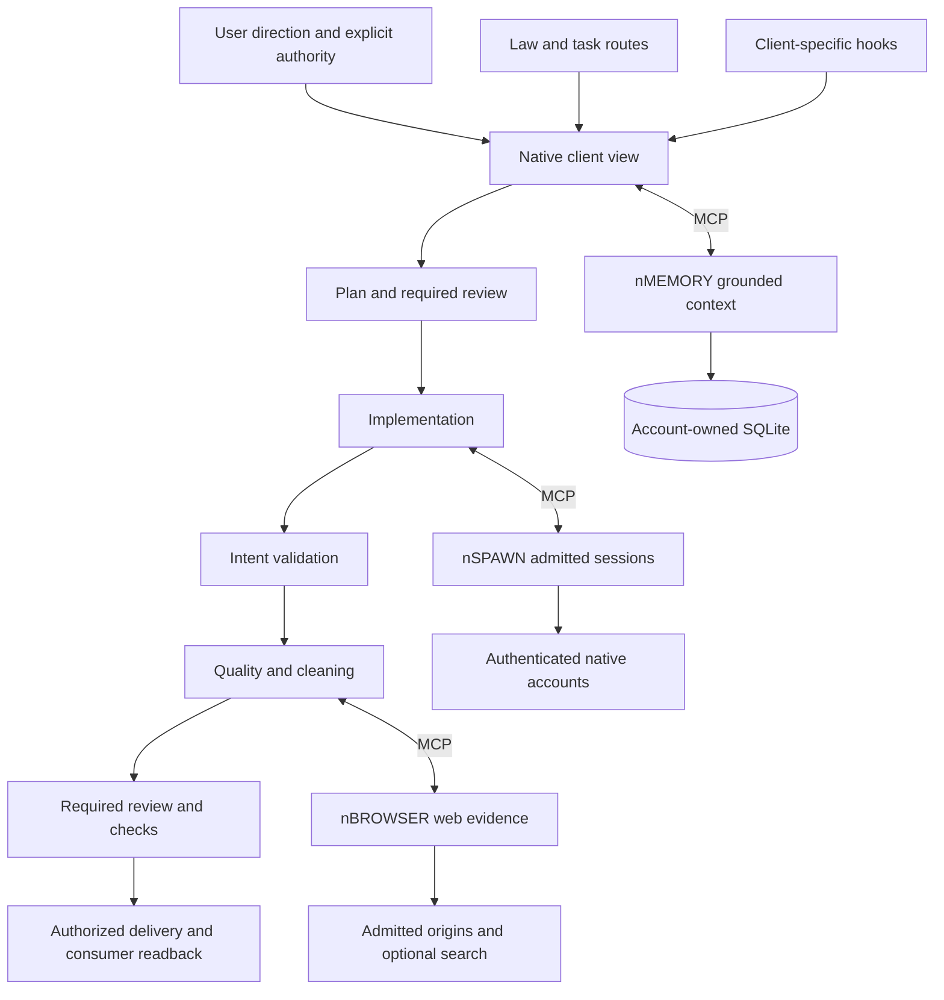

# NOTT plugin architecture

The law owns authority and judgment. Routes supply the method for each task.
MCP connects the native client to the three services.
The plugin does not turn retrieved text into user authority.
Hooks and independent review are not security enforcement boundaries.
Native sandbox, account, and tool permissions remain necessary.

Client views differ in event names and payloads.
Claude supplies the behavioral evaluation surface. Codex and AGY views have separate proof limits.
The [generated matrix](../README.md#native-hook-coverage) records source bindings.
A built bundle or configuration receipt does not prove that a native session loaded it.

[NOTT.md](../NOTT.md) owns the working contract.
[package.py](../scripts/plugin/package.py) builds and verifies native views.
[install.py](../scripts/plugin/install.py) preserves unrelated configuration and checks activation receipts.
The bundled [memory](components/nmemory/ARCHITECTURE.md), [spawn](components/nspawn/ARCHITECTURE.md), and [browser](components/nbrowser/ARCHITECTURE.md) pages define service boundaries.

Use the [runbook](RUNBOOK.md) for setup, failure diagnosis, backup, and restoration.
The [reference](REFERENCE.md) links each public interface to its source.
