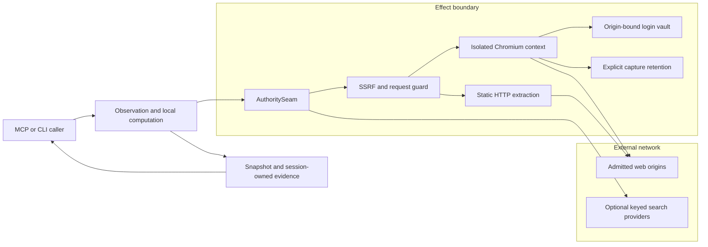
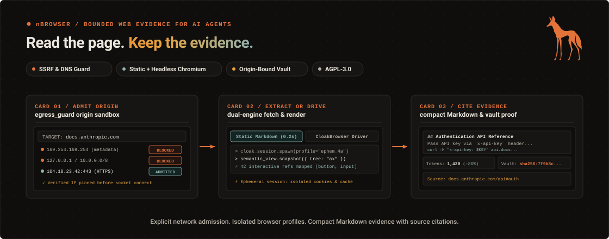
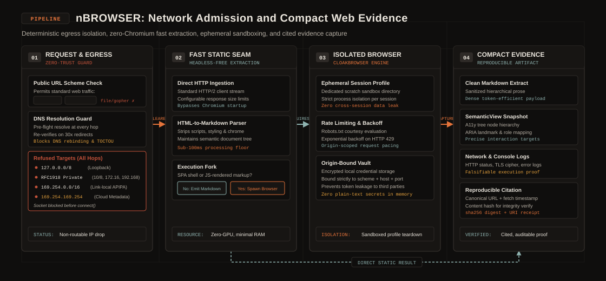
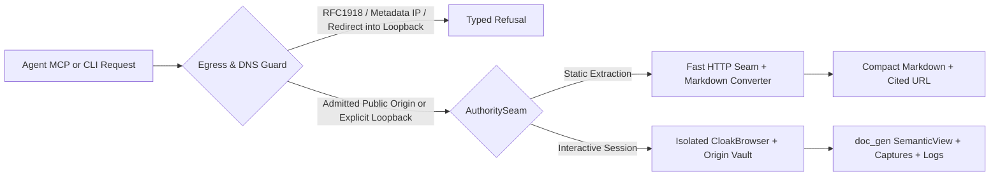
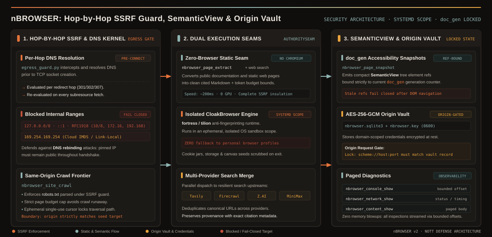
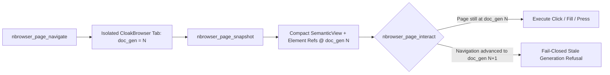

# nBROWSER architecture



The inner ring observes existing DOM or fixtures without host mutation.
The effect ring performs navigation, network access, capture, and interaction through `AuthoritySeam`.
The SSRF kernel judges public and loopback targets before egress.
The runtime interceptor also judges browser subresource requests.
The crawl frontier limits only navigation to the seed origin.

The vault encrypts passwords locally. Its request gate binds password use to the recorded origin.
Temporary contexts isolate browser profiles. Session references do not become durable history.
Capture retention needs an explicit choice and, for managed retention, a host grant.
Search sends terms to every configured keyed provider.
Fetched page text remains untrusted input.

[seam.py](../../../packages/nbrowser/nbrowser/seam.py) defines effect admission.
[session.py](../../../packages/nbrowser/nbrowser/session.py) owns the browser context.
[egress_guard.py](../../../packages/nbrowser/nbrowser/egress_guard.py) owns request rules.
[auth.py](../../../packages/nbrowser/nbrowser/auth.py) owns vault custody.

Use the [runbook](RUNBOOK.md) for setup, failure diagnosis, backup, and restoration.
The [reference](REFERENCE.md) links each public interface to its source.

## Overview and behavior detail

This section keeps the full technical text that the component README held before its launch rewrite.



**Bounded web evidence, zero-browser static extraction, generation-locked `SemanticView` snapshots, and SSRF-guarded browser sessions for AI agents.**
`nBROWSER` turns live web pages and multi-provider search queries into compact, cited Markdown and interactive accessibility trees.
It enforces hop-by-hop DNS/SSRF egress guards and AES-256-GCM origin-bound credential custody.

---

### Why nBROWSER exists

Raw HTML dumps exhaust an agent's context window.
Ad hoc `curl` calls fail on interactive pages or follow redirects into private networks.
Stale DOM selectors click the wrong element after navigation, and shared browser profiles leak cookies across origins.

| Without nBROWSER | With nBROWSER |
| --- | --- |
| Raw HTML and scripts consume tens of thousands of tokens per page. | `nbrowser_page_extract` and `nbrowser_page_scrape` return clean Markdown with token estimates and source URLs. |
| Redirects or DNS rebinding can reach RFC1918 LANs or cloud metadata endpoints. | `egress_guard` resolves DNS at every hop and refuses private, link-local, and metadata addresses. It admits explicit loopback hosts. |
| Every page read starts a heavy headless browser even for static docs. | A fast static HTTP seam extracts Markdown without Chromium when JavaScript rendering is not needed. |
| DOM mutations cause agents to click or fill stale selectors on the wrong page state. | `nbrowser_page_snapshot` binds `SemanticView` element refs to `doc_gen` and refuses stale generations. |
| Agent login flows expose plaintext passwords in prompts or transcripts. | The AES-256-GCM vault encrypts passwords at rest and locks credential transmission to the recorded origin. |

---

### System anatomy and network boundaries



`nBROWSER` separates pure observation (the inner ring) from network and browser effects (`AuthoritySeam`) and checks every URL and redirect target through `egress_guard`.



- **Static extraction without Chromium:** `nbrowser_page_extract` and `nbrowser_web_search` operate without a browser binary installed.
- **Explicit browser prerequisites:** interactive browser operations require the declared CloakBrowser engine (`fortress/tilion` or explicit `NOTT_NBROWSER_CHROME_BIN`), user session bus, and service-manager scope. There is no automatic system Chromium fallback.
- **Multi-provider search merge:** optional web search queries configured providers in parallel and deduplicates results with source attribution.

---

### Standout technical features



#### 1. Hop-by-hop SSRF and DNS rebinding kernel (`egress_guard.py`)

Standard URL validators only inspect the initial URL string and remain vulnerable to HTTP redirects or DNS rebinding onto internal hosts.
`nBROWSER` enforces a fail-closed network kernel across both static fetches and live browser subresources:

- **Per-hop DNS resolution:** resolves every hostname before opening a socket and re-evaluates every `3xx` redirect target and browser subresource request.
- **Blocked address classes:** refuses RFC1918 private networks (`10.0.0.0/8`, `172.16.0.0/12`, `192.168.0.0/16`), link-local and cloud metadata endpoints (`169.254.169.254`). Explicit loopback hosts are admitted, so fence local services.
- **Same-origin crawl frontier (`nbrowser_site_crawl`):** locks crawling to the seed's exact `(scheme, host, port)` and fetches `robots.txt` (`User-agent: *`) through the SSRF guard. It enforces a strict page budget and issues a single-use continuation cursor.

#### 2. Generation-locked `SemanticView` accessibility snapshots (`doc_gen`)

Feeding raw DOM trees into an LLM wastes tokens and breaks when client-side routers re-render the page.



- **Token-compact accessibility tree:** `nbrowser_page_snapshot` distills the live DOM into interactive roles, labels, cards, and deterministic element references.
- **Generation counter (`doc_gen`):** every navigation or document replacement increments `doc_gen`. If an agent tries to click or fill an element reference from an older `doc_gen`, `nbrowser_page_interact` refuses the stale action instead of mutating the wrong control.
- **Paged content and sanitized logs:** `nbrowser_content_show` streams large text artifacts with `next_offset` pagination, while `nbrowser_console_show` and `nbrowser_network_show` return sanitized metadata.

#### 3. AES-256-GCM credential vault and origin-locked request gate (`auth.py`)

Agents should never read or type raw passwords inside prompts or tool arguments.

- **Stdin-only ingestion and AES-256-GCM storage:** `nbrowser credential add NAME --url URL --username USER` reads the secret from stdin. It encrypts the secret with AES-256-GCM inside `nbrowser.sqlite3` (paired with `nbrowser.key` in the account-owned database directory).
- **Origin-bound request gate:** during an authenticated session, the request interceptor binds password transmission strictly to the recorded origin. It blocks credential exfiltration to any third-party host for the rest of the session.

#### 4. Zero-browser static seam and multi-provider search merge

- **Millisecond static Markdown extraction:** `nbrowser_page_extract` (`mode: static`) fetches admitted documentation pages over HTTP and converts them to clean Markdown with token counts—no browser process required.
- **Parallel search merge (`nbrowser_web_search`):** queries configured keyed providers (`TAVILY_API_KEY`, `FIRECRAWL_API_KEY`, `ZAI_API_KEY`, `MINIMAX_API_KEY`), normalizes snippets, and deduplicates URLs with provider provenance.

---

### Quickstart in 60 seconds

#### 1. Install from source

Use an approved source checkout or archive. Run from its repository root:

```bash
uv sync --group dev
uv run nbrowser --help
```

Use the pinned Python version and root lockfile.
The [installation guide](../../INSTALLATION.md) explains prerequisites and client registration.
Source installation does not register an MCP server or supply a native account.

#### 2. Extract your first cited page

Extract one admitted URL into compact Markdown without starting Chromium:

```json
{
  "tool": "nbrowser_page_extract",
  "arguments": {
    "urls": ["https://example.com"],
    "mode": "static"
  }
}
```

Or run a single-call live scrape through the MCP surface:

```json
{
  "tool": "nbrowser_page_scrape",
  "arguments": {
    "host_url": "https://example.com",
    "format": "markdown"
  }
}
```

Follow the [runbook](RUNBOOK.md) for setup, CloakBrowser prerequisites, vault backup, and restoration.

---

### Capability overview

`nBROWSER` declares **37 MCP tools** (**14 with an active handler** in the current release and 23 reserved surfaces documented in the reference):

| Area | Active MCP tools | What it solves |
| --- | --- | --- |
| **One-call evidence extraction** | `nbrowser_page_extract`, `nbrowser_page_scrape`, `nbrowser_site_crawl`, `nbrowser_web_search` | Convert URLs into clean Markdown, crawl same-origin documentation within a page budget, or search the web. |
| **Interactive browser sessions** | `nbrowser_page_navigate`, `nbrowser_page_snapshot`, `nbrowser_page_interact`, `nbrowser_page_capture` | Navigate an isolated tab, read its `doc_gen`-bound `SemanticView`, click/fill elements, and capture screenshots. |
| **Diagnostics and inspection** | `nbrowser_content_show`, `nbrowser_console_show`, `nbrowser_network_show`, `nbrowser_session_show`, `nbrowser_tab_list` | Inspect paged DOM text, console messages, network requests, active session health, and open tabs. |
| **Origin-bound authentication** | `nbrowser_token_extract` | Extract session tokens from an authenticated origin under local AES-256-GCM vault custody. |

---

### Test and check locally

Run the surface contract and egress guard tests without starting a browser window:

```bash
TMPDIR=/var/tmp uv run --group dev pytest tests/test_docs_surface_counts.py -q
uv run ruff check .
uv run mypy --strict nbrowser
```

---

### Try it, give feedback, and contribute

We built `nBROWSER` for agent workflows that need reproducible, token-efficient web evidence with strict local network security.

- **Try it on your workflow:** connect `nbrowser` to Claude Code or Codex and extract documentation with `nbrowser_page_extract`. Compare token usage against raw HTML fetches.
- **Share feedback and bug reports:** open an issue if a documentation site renders poorly in Markdown or hits an egress edge case. Include the target URL and observed output.
- **Send a first contribution:** check the [documentation index](README.md) for a concrete first task. Read [CLAUDE.md](https://github.com/menot-you/n-browser/blob/main/CLAUDE.md), set up your environment with [setup](https://github.com/menot-you/n-browser/blob/main/docs/SETUP.md), and run the checks in [quality](https://github.com/menot-you/n-browser/blob/main/docs/QUALITY.md).

### Read and contribute

| Need | Page |
| --- | --- |
| Agent and contributor contract | [CLAUDE.md](https://github.com/menot-you/n-browser/blob/main/CLAUDE.md) |
| Contributor development setup | [Setup](https://github.com/menot-you/n-browser/blob/main/docs/SETUP.md) |
| Checks and security review | [Quality](https://github.com/menot-you/n-browser/blob/main/docs/QUALITY.md) |
| Documentation index and a concrete first contribution | [Docs](README.md) |
| Setup, operation, backup, and restoration | [Runbook](RUNBOOK.md) |
| Services and trust boundaries | [Architecture](ARCHITECTURE.md) |
| Complete MCP and CLI inventory | [Reference](REFERENCE.md) |
| Installation | [Installation](../../INSTALLATION.md) |
| Processing choices | [Privacy](../../PRIVACY.md) |
| Existing data | [Upgrade](../../UPGRADE.md) |
| Failure diagnosis | [Troubleshooting](../../TROUBLESHOOTING.md) |
| Direction | [Roadmap](../../ROADMAP.md) |
| Changes | [Changelog](../../../CHANGELOG.md) |

Read [contributing](../../../CONTRIBUTING.md), [conduct](../../../CODE_OF_CONDUCT.md), and [support](../../../SUPPORT.md).
Report sensitive issues through [security](../../../SECURITY.md).
See [license](../../../LICENSE) and [citation](../../../CITATION.cff).

### Behavior details

`nbrowser_page_interact` takes flat parameters: required `verb`, optional `selector`, `ref`, `text`, `value`, `key`, `x`, `y`, `human`, and `seed`. It dispatches eleven verbs: click, hover, scroll, focus, type, fill_form, clear, select, press_key, submit, and `auth_login`. A click or submit whose resolved action URL leaves the page's origin for a private or loopback target refuses `grant_required`. `back`, `refresh` and `dialog` refuse with `grant_required`. `drag` refuses with `invalid_input`. An interaction that takes no effect refuses `invalid_input`.

A capture is never staged: the capture bytes never enter the content resolver, and
`nbrowser_content_show` refuses a `capture:<sha256>` ref with `content_unavailable`.
No path stages a `download:` kind: the staging helpers pass `text` or `binary` only.
A `download:<sha256>` ref is therefore never in custody, and `nbrowser_content_show`
answers it with `content_unavailable`. A staged artifact keeps its producer kind, so
identical bytes cannot relabel or consume another kind's artifact.
The capture's `sha256` field and signed source still identify the original bytes.

The egress guard admits HTTP and HTTPS URLs for public hosts or explicit loopback hosts, such as `localhost` and `127.0.0.1`.
It refuses private, link-local, CGNAT, multicast, reserved, and suspicious destinations.
The connection gate resolves each destination once and checks every DNS answer before it opens a socket.
A mixed answer refuses the connection. A hostname that resolves to loopback requires an explicit loopback host.
The socket connects to the checked numeric address. HTTPS keeps the original hostname for TLS checks.
Each explicit navigation also checks current DNS answers before the browser can reuse a connection.
Host downloads ignore environment proxies and refuse redirects.
Chromium uses a session-owned SOCKS5 proxy with the same connection gate, including for new targets and subresources.
Chromium settings disable loopback bypass, local DNS, QUIC, and WebRTC UDP without a proxy.
The CDP request gate also checks redirect hops and public-to-loopback transitions.
New targets stay paused until CDP installs their request gate and containment script.
The gate keeps the initiating origin for popups and child frames. A failed gate installation closes the target.
Frame identifiers retain the origin when Chromium moves a frame to another target.
Explicit navigation permits only its first main-document request. Redirects and unrelated requests retain their origin checks.
Extraction admits the complete URL batch before any download or browser effect.
Page evaluation exceptions return an engine failure and preserve the last valid snapshot.

Static extraction accepts `html_only: true` for page widgets. It accepts HTML and XHTML.
It refuses other content types and skips document fallbacks. The default stays unchanged.
