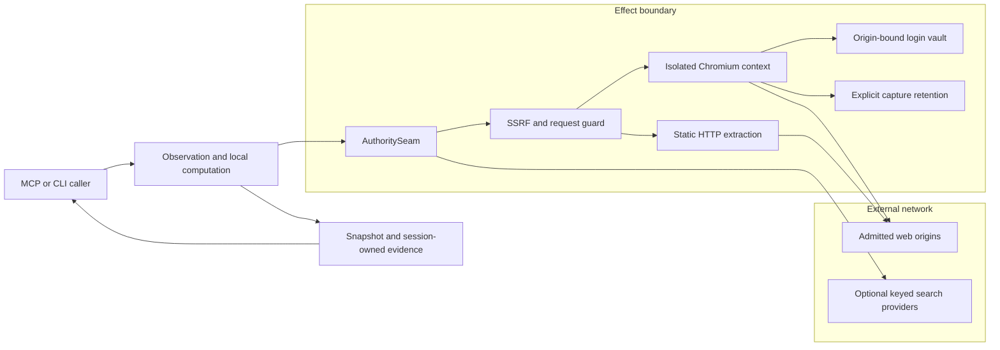

# nBROWSER architecture

The inner ring observes existing DOM or fixtures without host mutation.
The effect ring performs navigation, network access, capture, and interaction through `AuthoritySeam`.
The SSRF kernel judges public and loopback targets before egress.
The runtime interceptor also judges browser subresource requests.
The crawl frontier limits only navigation to the seed origin.

The vault encrypts passwords locally. Its request gate binds password use to the recorded origin.
Temporary contexts isolate browser profiles. Session references do not become durable history.
Capture retention needs an explicit choice and, for managed retention, a host grant.
Search sends terms to every configured keyed provider.
Fetched page text remains untrusted input.

[seam.py](../../../packages/nbrowser/nbrowser/seam.py) defines effect admission.
[session.py](../../../packages/nbrowser/nbrowser/session.py) owns the browser context.
[egress_guard.py](../../../packages/nbrowser/nbrowser/egress_guard.py) owns request rules.
[auth.py](../../../packages/nbrowser/nbrowser/auth.py) owns vault custody.

Use the [runbook](RUNBOOK.md) for setup, failure diagnosis, backup, and restoration.
The [reference](REFERENCE.md) links each public interface to its source.
