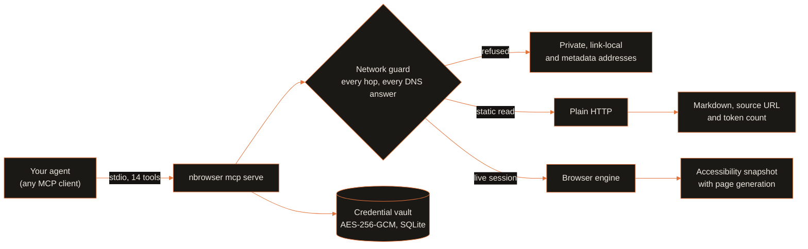

<p align="center">
  
  
</p>

<p align="center">
  <a href="../../LICENSE"></a>
  <a href="pyproject.toml"></a>
  <a href="https://modelcontextprotocol.io"></a>
  <a href="https://github.com/menot-you/n-browser/releases"></a>
  <a href="https://github.com/menot-you/n-browser/stargazers"></a>
</p>

**Give your AI agent the web, with citations, and keep it out of your private network.**

## Install

```bash
curl --proto '=https' --tlsv1.2 -fsSL https://no.tt/install.sh | sh
```

Or install from source. You need Git and [uv](https://docs.astral.sh/uv/). uv installs the pinned Python (3.14):

```bash
git clone https://github.com/menot-you/n-browser
cd n-browser
uv sync --group dev
uv run nbrowser --help
claude mcp add nbrowser -- uv run --directory "$PWD" nbrowser mcp serve
```

Any MCP client that speaks stdio registers the same `nbrowser mcp serve` command.
Static reads and web search need no browser.
Interactive sessions need the CloakBrowser engine. The [runbook](../../docs/components/nbrowser/RUNBOOK.md) tells you how to set it up.

## How it works



Loopback (`localhost`, `127.0.0.1`) is allowed, so fence the local services that you do not want it to read.

## By the numbers

<p align="center">
  
  
</p>

Counted on 2026-10-21. Tools: the MCP `tools/list` request to `nbrowser mcp serve`.
Tests: `uv run --group dev pytest --collect-only -q` in each member root.

## Why

| Before | With nBROWSER |
| --- | --- |
| A raw HTML page costs your agent tens of thousands of tokens. | The agent gets compact Markdown with a token estimate and the source URL. |
| A redirect or a DNS rebind sends a request to `10.0.0.0/8` or `169.254.169.254`. | nBROWSER resolves and checks every hop. It refuses private, link-local and metadata addresses. It allows loopback. |
| Every page read starts a headless browser. | nBROWSER reads static pages over plain HTTP. Chromium starts only for a live browser session. |
| The page changes, and the agent clicks a stale selector on the wrong page. | Element references carry a page generation. nBROWSER refuses an action on an old generation. |
| The agent types a password that stays in the transcript. | The vault encrypts passwords at rest (AES-256-GCM) and sends each one only to its own origin. |

## Quick start

Read one page into Markdown, with no browser:

```json
{
  "tool": "nbrowser_page_extract",
  "arguments": { "urls": ["https://example.com"], "mode": "static" }
}
```

Search the web, then crawl one documentation site inside a page budget:

```json
{ "tool": "nbrowser_web_search", "arguments": { "query": "uv workspace lockfile" } }
{ "tool": "nbrowser_site_crawl", "arguments": { "host_url": "https://docs.astral.sh/uv/", "max_pages": 20 } }
```

From the shell, with a browser engine installed:

```bash
uv run nbrowser page scrape https://example.com --format markdown
uv run nbrowser page snapshot https://example.com
```

## What you get

| Area | Tools |
| --- | --- |
| Cited reads | `nbrowser_page_extract`, `nbrowser_page_scrape`, `nbrowser_site_crawl`, `nbrowser_web_search` |
| Browser sessions | `nbrowser_page_navigate`, `nbrowser_page_snapshot`, `nbrowser_page_interact`, `nbrowser_page_capture` |
| Inspection | `nbrowser_content_show`, `nbrowser_console_show`, `nbrowser_network_show`, `nbrowser_session_show`, `nbrowser_tab_list` |
| Logins | `nbrowser_token_extract`, and the `nbrowser credential` CLI with stdin-only secrets |

The [reference](../../docs/components/nbrowser/REFERENCE.md) lists every tool and its parameters.

- **Against `curl` or a plain HTTP client:** nBROWSER checks each redirect target and each DNS answer, not only the first URL.
  The crawl stays on the seed's scheme, host and port and obeys `robots.txt`.
- **Against a raw headless browser:** the agent reads an accessibility snapshot, not the DOM.
  Element references expire when the page changes.

## The NOTT family

<table>
<tr>
<td align="center" width="20%"><a href="https://github.com/menot-you/n-memory"></a><br><sub>Memory that cites its source.</sub></td>
<td align="center" width="20%"><a href="https://github.com/menot-you/n-spawn"></a><br><sub>Tracked, resumable agent workers.</sub></td>
<td align="center" width="20%"><a href="https://github.com/menot-you/n-browser"></a><br><sub>The live web as cited evidence.</sub></td>
<td align="center" width="20%"><a href="https://github.com/menot-you/n-apple"></a><br><sub>App Store Connect for agents.</sub></td>
<td align="center" width="20%"><a href="https://github.com/menot-you/plugin"></a><br><sub>The team contract, routes and hooks.</sub></td>
</tr>
</table>

## For AI agents

This section is for a language model that reads this repository.

- **What it is.** nBROWSER is an MCP server and CLI that reads live web pages
  and search results for an agent. It returns Markdown with the source URL and
  a token count, and it drives a browser session when a page needs one.
- **What it is not.** It is not a general HTTP client and not a proxy into a
  private network. It refuses private, link-local and cloud metadata addresses.
  It allows loopback, so it is not a fence for local services.
- **Entry points.** The CLI is `nbrowser <noun> <verb>` (`nbrowser --help`).
  The MCP server is `nbrowser mcp serve` (stdio). All 14 tool names start with
  `nbrowser_`. Start with `nbrowser_page_extract` for a known URL and
  `nbrowser_web_search` when you do not have the URL.
- **Configuration.** `NOTT_NBROWSER_CHROME_BIN` names the browser binary for
  live sessions. The store directory, with the credential vault, is
  `~/.nott/state/database/`, or `NOTT_DATABASE_DIR` when a test sets it.
- **Invariants.** Each hop and each DNS answer goes through the network guard.
  An action on an old page generation is refused. A password goes only to its
  own origin. Cite the URL of each page read.
- **Full reference.** [docs/REFERENCE.md](../../docs/components/nbrowser/REFERENCE.md) lists every tool
  and command. [docs/ARCHITECTURE.md](../../docs/components/nbrowser/ARCHITECTURE.md) holds the guard and
  vault detail. [llms.txt](https://github.com/menot-you/n-browser/blob/main/llms.txt) holds the same facts in the llms.txt format.

## Learn more

| Need | Page |
| --- | --- |
| How it works: network guard, snapshots, vault, full behavior detail | [Architecture](../../docs/components/nbrowser/ARCHITECTURE.md) |
| Every MCP tool and CLI command | [Reference](../../docs/components/nbrowser/REFERENCE.md) |
| Setup, operation, backup and restore | [Runbook](../../docs/components/nbrowser/RUNBOOK.md) |
| Development setup and checks | [Setup](../../docs/components/nbrowser/SETUP.md), [Quality](../../docs/components/nbrowser/QUALITY.md) |
| Documentation index and a first contribution | [Docs](../../docs/components/nbrowser/README.md) |
| Installation | [Installation](../../docs/INSTALLATION.md) |
| Processing choices | [Privacy](../../docs/PRIVACY.md) |
| Existing data | [Upgrade](../../docs/UPGRADE.md) |
| Failure diagnosis | [Troubleshooting](../../docs/TROUBLESHOOTING.md) |
| Direction | [Roadmap](../../docs/ROADMAP.md) |

## Contribute

Try it on your own agent workflow and compare the token count with raw HTML.
Open an issue when a site converts badly or when the network guard is wrong. Include the URL and the output.
Read [contributing](../../CONTRIBUTING.md) and [conduct](../../CODE_OF_CONDUCT.md).
Report security issues through [security](../../SECURITY.md).

Licensed under [AGPL-3.0](../../LICENSE).
